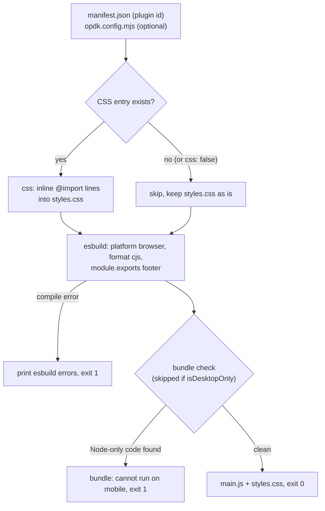
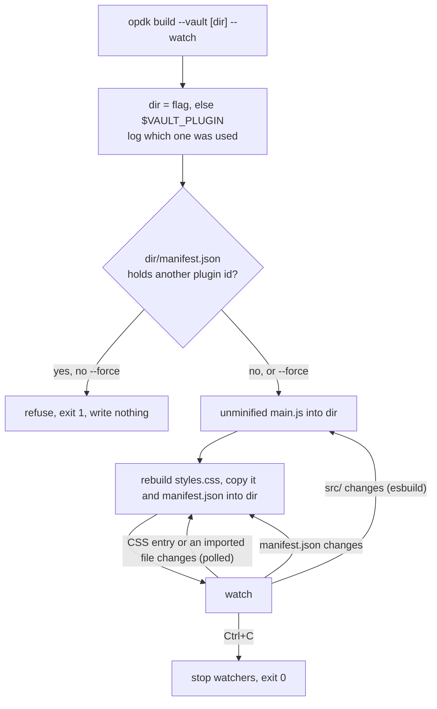

# obsidian-plugin-dev-kit

Build, lint, release, test and film [Obsidian](https://obsidian.md/) plugins from one dev dependency.

> **Status: work in progress, nothing to install yet.** The code is being moved here from three plugins that each kept their own copy: [Snipsy](https://github.com/Dimagious/snipsidian), [Dashy](https://github.com/Dimagious/dashsidian) and [Garmy](https://github.com/Dimagious/garmidian). The roadmap below shows what is done.

## Why

Every Obsidian plugin needs the same tooling around its code: a bundle that also runs on phones, a lint setup that matches the community plugin scanner, a release workflow, end-to-end tests in a real Obsidian, and a demo GIF for the README. Copying it between plugins works until the copies drift. In the three plugins above, a fix for the mobile build reached two of them and not the third. This kit keeps that tooling in one place and versions it.

## What it will include

| Module | What it does |
|---|---|
| Build | esbuild for the browser platform, so the bundle works on mobile, plus a check that fails if Node-only code gets into `main.js`; CSS build; copy into a dev vault in watch mode |
| Scanner and lint | An ESLint config that matches the community plugin scanner's, with `eslint-plugin-obsidianmd` pinned in one place, and a scorecard check that runs before you release |
| Release | Version sync between `package.json`, `manifest.json` and `versions.json`, tag checks, and a reusable GitHub release workflow with build provenance |
| Unit tests | A Vitest preset with coverage thresholds, and DOM helpers Obsidian adds (`createEl`, `createDiv`, `setText`) |
| End-to-end tests | Playwright in a real Obsidian: an isolated vault per test, the trust dialog handled, a check of which Obsidian version ran, launch through Electron or CDP, IME composition input, and a mode for recording tests by hand with the Playwright Inspector |
| Demo recording | A visible cursor that moves like a person's, subtitles, slow typing and pauses, plus a script that cuts the take and adds a voice-over per scene with ffmpeg, then exports MP4 and GIF |
| Integration tests | A preset for [obsidian-integration-testing](https://github.com/mnaoumov/obsidian-integration-testing): the same smoke tests on the latest public and catalyst builds, and on Android |
| Agent skills | One Claude Code skill per module, so a coding agent working in your plugin knows how to use the kit |

Your plugin keeps only what is its own: specs, the seed vault, demo scenes and voice-over text.

## Install (planned)

No tag exists yet, so these commands do not work today. Replace `vX.Y.Z` with the first tag once it is out.

```bash
npm install --save-dev github:Dimagious/obsidian-plugin-dev-kit#vX.Y.Z
npx opdk --help
```

## Build

`opdk build` builds your plugin's CSS, bundles the plugin with esbuild for the browser platform, and then checks `main.js` for code that only exists under Node.

Why: Dashy 1.0.0 failed on every phone. Its build passed `--platform=node`, so esbuild took the `node` branch of the `yaml` package's export map and bundled a build that reads `process.env`. Desktop Obsidian has `process`, so the bug only showed on mobile. Snipsy's current bundle has the same problem. Platform `browser` is fixed here, and the check fails the build if Node-only code gets in anyway (skipped when `manifest.json` says `isDesktopOnly: true`).


### What `opdk build` does



`opdk build --vault --watch` is the dev loop. It builds into your dev vault instead and does not run the bundle check:



A compile error in watch mode is printed and the watch keeps going; fix the file and the next build recovers. The same goes for CSS: when a step fails on a broken `@import`, the files it had read stay polled, so fixing any of them triggers the next sync. If the CSS entry does not exist when the watch starts, it prints `no <entry>, CSS not watched` once and polls only `manifest.json`; esbuild still watches the sources.

### Quick start

In `package.json`:

```json
{
  "scripts": {
    "build": "opdk build",
    "dev:vault": "opdk build --vault --watch"
  },
  "devDependencies": {
    "obsidian-plugin-dev-kit": "github:Dimagious/obsidian-plugin-dev-kit#vX.Y.Z"
  }
}
```

Replace `vX.Y.Z` with the latest tag and pin it exactly.

`opdk.config.mjs` is optional. Without it you get the defaults in the table below:

```js
import { defineConfig } from "obsidian-plugin-dev-kit";

export default defineConfig({
    build: {
        loader: { ".png": "dataurl" },
        external: ["some-package"],
    },
});
```

For the dev loop, point the kit at the plugin folder inside your dev vault, either with `VAULT_PLUGIN` or with `--vault`:

```bash
VAULT_PLUGIN="$HOME/vault/.obsidian/plugins/my-plugin" npm run dev:vault
opdk build --vault ~/vault/.obsidian/plugins/my-plugin
```

`VAULT_PLUGIN` tends to stay exported in a shell. The build prints where the target came from (`from --vault` or `from VAULT_PLUGIN`) and refuses a folder whose `manifest.json` holds another plugin id, so a stale variable cannot overwrite a different plugin. Pass `--force` to overwrite anyway. A folder that resolves to the plugin root, or a value starting with `~` (nothing expands it), is refused even with `--force`.

### Options

All keys go under `build` in `opdk.config.mjs` and are optional. The file is read once when the command starts; after editing it, restart `--watch`.

| Key | Type | Default | Meaning |
|---|---|---|---|
| `entry` | string | `"src/main.ts"` | Bundle entry |
| `outfile` | string | `"main.js"` | Bundle output |
| `minify` | boolean | `true` | Minify the release bundle. Vault builds are never minified |
| `target` | string | `"es2020"` | esbuild target |
| `external` | string[] | `[]` | Added to the always-external `obsidian`, `electron`, `@codemirror/state`, `@codemirror/view` |
| `loader` | object | `{ ".css": "text" }` | esbuild loader per extension, for example `{ ".png": "dataurl" }`. Your entries merge over the default, so an `import` of a `.css` file is a string unless you say otherwise |
| `css` | object or `false` | `{ entry: "src/styles/main.css", outfile: "styles.css" }` | CSS bundler, or `false` to skip it |
| `css.entry` | string | `"src/styles/main.css"` | CSS entry. `--watch` polls it and every file it imports |
| `css.outfile` | string | `"styles.css"` | CSS output |

Platform `browser`, format `cjs` and the footer that makes `module.exports` the plugin class are not configurable.

Flags of `opdk build`:

| Flag | Meaning |
|---|---|
| `--vault [dir]`, `--vault=<dir>` | Build into a dev vault: unminified `main.js` in `dir`, then rebuilds `styles.css` and copies it and `manifest.json` there. `dir` defaults to `$VAULT_PLUGIN`. No bundle check. With `css: false`, a `styles.css` in the plugin root is copied if present |
| `--watch` | With `--vault`: rebuild on changes to the sources, the CSS entry and every file it imports (polled every 300 ms), and `manifest.json`. Stop with Ctrl+C |
| `--force` | With `--vault`: write into a folder whose `manifest.json` holds a different plugin id |

Other commands: `opdk build-css` runs only the CSS step (exit 1 when the CSS entry does not exist; with `css: false` it prints that CSS is disabled and exits 0), `opdk assert-bundle [file]` runs only the bundle check (`file` defaults to the build outfile).

The CSS bundler inlines `@import "x.css"` lines recursively, each path relative to the file that contains it. A missing import or an import cycle is an error that names the files. `@import` of a URL is left for the browser. If the CSS entry does not exist, `opdk build` skips the step and a hand-written `styles.css` stays as it is.

### Example output

A clean build (the plugin id comes from `manifest.json`):

```text
$ opdk build
✓ css     src/styles/main.css -> styles.css (2 files, 4 lines)
· build   hello-plugin: bundling src/main.ts
✓ build   hello-plugin: main.js 0.6 KB
✓ bundle  main.js is free of Node-only references (0.6 KB)
```

`✓` is a step that passed, `✗` a step that failed, `·` progress and `!` a warning. Failures and esbuild's own messages go to stderr; the `✓ · !` lines go to stdout. In a terminal the lines are coloured (green, red, yellow, dim); piped into a file you get the same text without escape codes. Colour rules, in order: a non-empty `NO_COLOR` turns it off; `FORCE_COLOR` turns it on for any value except `0` and `false` (an empty value counts), even on a pipe or with `TERM=dumb`; `TERM=dumb` turns it off; `GITHUB_ACTIONS=true` turns it on, since the Actions log viewer renders it; otherwise colour needs a terminal. The format is for people: do not parse it in scripts, use the exit code.

A bundle the check rejects. The source reads `process.env.HOME`, which does not exist on a phone:


```text
$ opdk build
✓ css     src/styles/main.css -> styles.css (1 file, 2 lines)
· build   hello-plugin: bundling src/main.ts
✓ build   hello-plugin: main.js 0.8 KB
✗ bundle  main.js cannot run on mobile:
            - a `process` reference: "process.env"
          Check the esbuild platform: an Obsidian plugin bundles as `browser`.
$ echo "exit code: $?"
exit code: 1
```

Read it from the top: the bundle was written, then the check found a Node-only reference and failed the build. Each `-` line names one finding, and the last line says what to check. A `process`, `node:` or `__dirname` line means your code or a dependency reaches for Node; a marker such as `LOG_TOKENS` means a dependency's Node build got bundled. A build error from esbuild itself is printed in esbuild's layout, followed by `build failed with N error(s)`, and also exits 1.

The vault build prints where it writes, and refuses a folder that belongs to another plugin:

```text
$ opdk build --vault ~/vault/.obsidian/plugins/hello-plugin
· build   hello-plugin: vault target /Users/me/vault/.obsidian/plugins/hello-plugin (from --vault)
✓ build   hello-plugin: built /Users/me/vault/.obsidian/plugins/hello-plugin/main.js
✓ css     src/styles/main.css -> styles.css (1 file, 2 lines)
✓ build   hello-plugin: assets copied to /Users/me/vault/.obsidian/plugins/hello-plugin

$ VAULT_PLUGIN=~/vault/.obsidian/plugins/snipsy opdk build --vault
· build   hello-plugin: vault target /Users/me/vault/.obsidian/plugins/snipsy (from VAULT_PLUGIN)
✗ build   hello-plugin: /Users/me/vault/.obsidian/plugins/snipsy holds plugin snipsy, not hello-plugin. Check VAULT_PLUGIN / --vault, or pass --force to overwrite it.
```

### esbuild in your plugin

The kit pins `esbuild` 0.28.2 and `opdk build` uses it, so a plugin needs no esbuild of its own for the build. Drop the plugin's own `esbuild` devDependency once no script of yours calls esbuild directly. Until then, pin the same version the kit does; otherwise you carry two binaries at two versions.

## Roadmap

- [ ] Wave 1: build, scanner and lint, end-to-end harness, demo recording
- [ ] Wave 2: release tooling and the reusable workflow
- [ ] Wave 3: integration tests preset
- [ ] Wave 4: unit-test helpers and Obsidian mocks
- [ ] Agent skills for each module, written along with the module

Each module moves to Garmy first, then Dashy, then Snipsy. A plugin may change when it adopts a module (for example, Snipsy's bundle switches to the browser platform); each such change is listed in that plugin's changelog and checked by its end-to-end tests.

## Development

Requires Node 22.12 or newer.

```bash
npm ci
npm run typecheck   # tsc over src, bin, tests and config files
npm run lint        # eslint, zero warnings allowed
npm test            # vitest with coverage thresholds (90% lines, functions and statements, 80% branches)
npm run build       # cleans dist/ and compiles src/ with tsc
npm run smoke       # builds, packs, installs the tarball into a temp project, runs opdk --help, --version and `opdk build` on a fixture, imports defineConfig
npm run docs:media  # re-records the GIFs in docs/media with VHS (needs `vhs` and `ffmpeg`); run `npm run build` first
```

`dist/` is not committed. `npm install` from a git tag runs `prepare`, which builds it, so a broken build breaks every plugin install. CI runs the same checks plus the smoke on every pull request.

Releasing: bump `version` in `package.json`, move the `[Unreleased]` entries in `CHANGELOG.md` under the new version, merge, then the owner tags `vX.Y.Z` and pushes the tag. A workflow fails the tag if it differs from `package.json`. Plugins pin the tag, for example `github:Dimagious/obsidian-plugin-dev-kit#vX.Y.Z`.

## Credits

The kit uses or borrows from: [obsidian-integration-testing](https://github.com/mnaoumov/obsidian-integration-testing) and [obsidian-dev-toolkit](https://github.com/mnaoumov/obsidian-dev-toolkit) by Michael Naumov, the [community plugin scanner configuration](https://github.com/obsidianmd/eslint-plugin) from `eslint-plugin-obsidianmd`, and [Playwright](https://playwright.dev/).

## License

MIT
