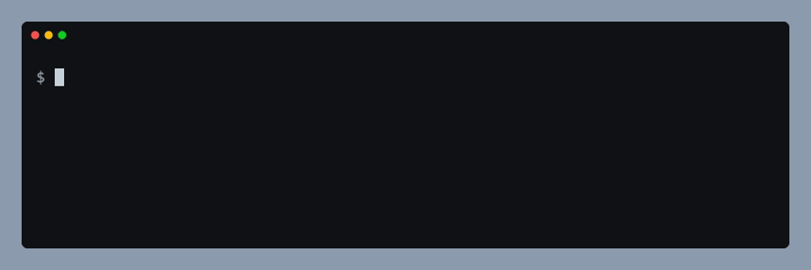
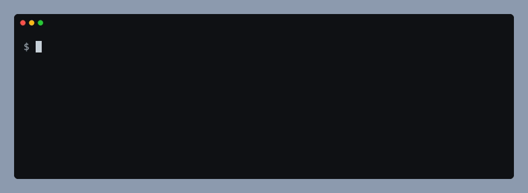
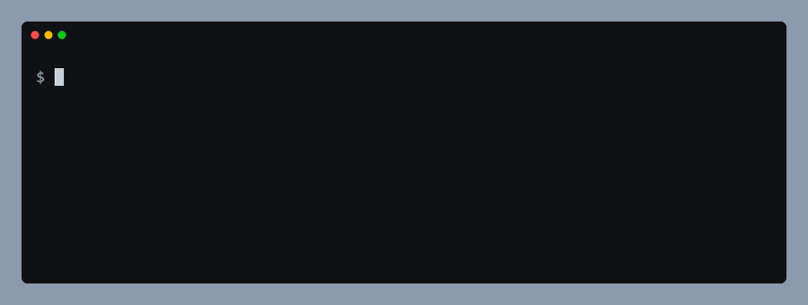
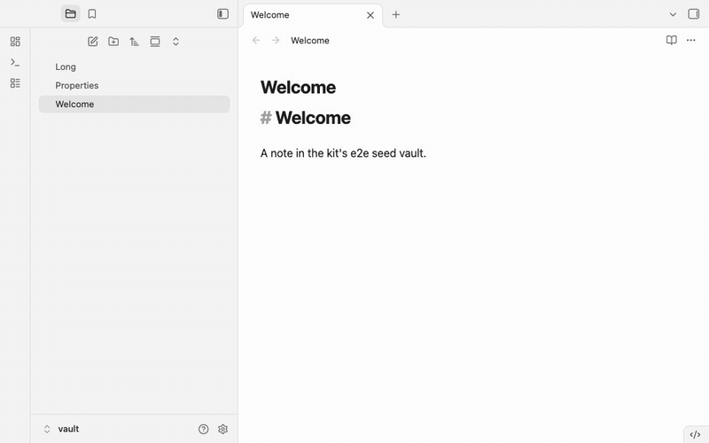

# obsidian-plugin-dev-kit

Build, lint, release, test and film [Obsidian](https://obsidian.md/) plugins from one dev dependency.

> **Status: work in progress, nothing to install yet.** The code is being moved here from three plugins that each kept their own copy: [Snipsy](https://github.com/Dimagious/snipsidian), [Dashy](https://github.com/Dimagious/dashsidian) and [Garmy](https://github.com/Dimagious/garmidian). The roadmap below shows what is done.

## Why

Every Obsidian plugin needs the same tooling around its code: a bundle that also runs on phones, a lint setup that matches the community plugin scanner, a release workflow, end-to-end tests in a real Obsidian, and a demo GIF for the README. Copying it between plugins works until the copies drift. In the three plugins above, a fix for the mobile build reached two of them and not the third. This kit keeps that tooling in one place and versions it.

## What it will include

| Module | What it does |
|---|---|
| Build | esbuild for the browser platform, so the bundle works on mobile, plus a check that fails if Node-only code gets into `main.js`; CSS build; copy into a dev vault in watch mode |
| Scanner and lint | `opdk scan` runs the community plugin scanner's ESLint configuration and its CSS, source and manifest checks before you release, with `eslint-plugin-obsidianmd` pinned in one place; `obsidianPlugin()` gives your own `eslint.config.js` the same base |
| Release | `opdk release check` for CI and before a tag: versions in `package.json`, `manifest.json`, `package-lock.json` and `versions.json`, the manifest rules of the official Obsidian action, a CHANGELOG section, a production build built twice (working tree and committed tree) and compared, and the `minAppVersion` against the API the code calls. `opdk release patch` (or `minor`, `major`, `X.Y.Z`) bumps the files, moves the `[Unreleased]` notes under the new version, commits and tags, pushes only the tag, waits for the kit's reusable GitHub workflow, verifies its draft release (files, bytes against a local build of the tag, notes, build provenance), publishes it and only then pushes the branch. Release notes come from the CHANGELOG, and no zip is made unless asked |
| Reusable CI | `plugin-ci.yml`, a reusable GitHub workflow: lint, typecheck, tests, `opdk scan`, `opdk release check`, build and bundle upload, with a read-only token, actions pinned to commit SHAs and a pinned runner |
| Unit tests | `defineUnitConfig()`, a Vitest config with v8 coverage and a 90/80 gate, an `obsidian` alias, and a split that runs only the files that need a DOM in jsdom; plus the DOM helpers Obsidian adds (`createEl`, `createDiv`, `setText`, `addClass`, `activeDocument` and more) for jsdom |
| End-to-end tests | Playwright in a real Obsidian through Electron: an isolated vault per test, the trust dialog never shown, readiness by plugin state instead of sleeps, a check of which Obsidian version ran, a trace and a video of the Obsidian window for failures, and helpers for settings, commands, the editor, IME composition, the mobile layout and fakes. Launch over CDP and a mode for recording tests by hand with the Playwright Inspector are planned |
| Demo films | Films of stills from the real Obsidian: a frozen UI, a visible cursor or tap dot, captions, slow typing, light and dark themes, and a privacy guard that refuses to film a vault that is not the plugin's own; `opdk demo` encodes them to MP4, GIF and poster with ffmpeg, can put a phone film beside its captions, and copies stills (shot at a fixed density) for the README and listings. No audio |
| Integration tests | A preset for [obsidian-integration-testing](https://github.com/mnaoumov/obsidian-integration-testing): the same smoke tests on the latest public and catalyst builds, and on Android |
| Agent skills | One Claude Code skill per module, so a coding agent working in your plugin knows how to use the kit |

Your plugin keeps only what is its own: specs, the seed vault and demo scenes.

## Install (planned)

No tag exists yet, so these commands do not work today. Replace `vX.Y.Z` with the first tag once it is out.

```bash
npm install --save-dev github:Dimagious/obsidian-plugin-dev-kit#vX.Y.Z
npx opdk --help
```

## Build

`opdk build` builds your plugin's CSS, bundles it with esbuild for the browser platform, and then checks `main.js` for code that only exists under Node. Dashy 1.0.0 failed on every phone because its build passed `--platform=node`: esbuild took the `node` branch of the `yaml` package and bundled code that reads `process.env`. Desktop Obsidian has `process`, so only mobile showed it. The platform is fixed here, and the check fails the build if Node-only code gets in anyway.



When Node-only code gets into the bundle, the build fails:



Quick start: `npx opdk build`. Details: [docs/build.md](docs/build.md).

## Scanner

`opdk scan` runs the community plugin scanner's own ESLint configuration (published upstream), a CSS check and a few source checks that reproduce findings seen on plugin listings, over the files git tracks. It fails when a step has a finding; the scanner's ESLint warnings count as findings, advisory `!` lines do not. Dashy lost three points of its public score to a joined domain string that no local check saw; this catches that kind of thing before the tag.



Quick start: `npx opdk scan`. Details: [docs/scanner.md](docs/scanner.md).

## End-to-end tests

`obsidian-plugin-dev-kit/e2e` runs Playwright specs in the real Obsidian: every test gets its own Obsidian process, a copy of your seed vault and a fresh user-data folder, with your built plugin installed and trusted before the window opens. Obsidian 1.13 moved Settings into a second window and took down five of Dashy's specs at once, and Snipsy pressed Escape on the trust dialog and slept to let plugins load. The kit keeps Settings in the main window, sets the trust flag before the vault loads and waits for every plugin's `onload()` to finish, and a failed test leaves a trace and a video of the Obsidian window.



Quick start: `createObsidianTest({ seedVault })` in `e2e/fixtures.ts`, `defineObsidianConfig()` in `playwright.config.ts`, then `npx playwright test`. Details: [docs/e2e.md](docs/e2e.md).

## Demo films

The `demo` fixture records your plugin in the real Obsidian as a film of stills: each shot freezes the UI and takes a sharp picture at 2x, with a hold and a caption, and `opdk demo` turns the film into an MP4, a GIF and a poster. Snipsy recorded the Obsidian window and needed Python to finish the job, Garmy's retake appended frames to the old film, and Dashy's reel script only warned when ffmpeg failed, so a run that made no GIF still ended green. Here the timing is the script's, a retake replaces the frames, a failed encode fails the film, and a film of a vault that is not the plugin's own is refused.


Quick start: `demo.film({ kind: "phone", captions })` and `film.shot({ hold })` in a gated spec, then `npx opdk demo`. For captions beside the phone, set `layout: "phone-captions"` in the `demo` section of `opdk.config.mjs`. Details: [docs/demo.md](docs/demo.md).

## Releases

`opdk release` checks a commit, bumps the version everywhere, tags it and publishes the GitHub release, pushing the branch last so the manifest on the default branch moves only after the release is public. Plugins that pushed the branch and the tag together let the directory read a new `manifest.json` before the release workflow had finished, and their hand-written CHANGELOG never reached the release page. Here only the tag is pushed first, the kit's reusable workflow builds, attests and creates a draft with the CHANGELOG section as notes, and `opdk release` checks the draft byte for byte against a build of the tag on your machine before it publishes. The incidents behind this, in [docs/release.md](docs/release.md).

Quick start: a tag workflow in the plugin that calls the kit's, pinned to a full commit SHA of the kit,

```yaml
# .github/workflows/release.yml
name: Release
on:
  push:
    tags: ['*.*.*']
permissions:
  contents: write
  id-token: write
  attestations: write
jobs:
  release:
    uses: Dimagious/obsidian-plugin-dev-kit/.github/workflows/release.yml@<full commit SHA of the kit>
```

then `npx opdk release check` to see what would stop a release, and `npx opdk release patch` to cut one (it needs the GitHub CLI signed in with write access, and `scripts.build` must run `opdk build`). Details, every stop and how to resume: [docs/release.md](docs/release.md).

## Continuous integration

`.github/workflows/plugin-ci.yml` is a reusable workflow that checks a plugin on every push and pull request: lint, typecheck, unit tests, `opdk scan`, `opdk release check`, the build, and an upload of the bundle as `<plugin id>-bundle`. The three plugins each kept a 45 to 75 line `ci.yml` that had drifted (Snipsy's never ran its lint script). Here the job has a read-only token, every action is pinned to a commit SHA, the runner is pinned to `ubuntu-24.04` instead of `ubuntu-latest`, and the inputs are switches, never commands. Steps that belong to one plugin stay in a second job of its own `ci.yml`.

Quick start: call it from the plugin's `ci.yml`, pinned to a full commit SHA of the kit,

```yaml
# .github/workflows/ci.yml
name: ci
on:
  push:
    branches: [main]
  pull_request:
permissions:
  contents: read
jobs:
  kit:
    uses: Dimagious/obsidian-plugin-dev-kit/.github/workflows/plugin-ci.yml@<full commit SHA of the kit>
```

Dashy's default branch is `master`, so its caller uses `branches: [master]`. Inputs (all optional): `node-version`, `runs-on`, and a boolean per step (`lint`, `typecheck`, `test`, `scan`, `release-check`, `build`, `upload-bundle`, `coverage-artifact`). Inputs, what each step runs, how to add plugin-specific steps and what changes for each plugin: [docs/ci.md](docs/ci.md).

## Unit tests

`defineUnitConfig()` from `obsidian-plugin-dev-kit/vitest` is a Vitest config for Obsidian plugins: tests in `src/**/*.test.ts`, v8 coverage with a gate of 90 percent (80 for branches), an `obsidian` alias, and a list of the test files that need a DOM. Those files run in jsdom with Obsidian's DOM helpers (`createDiv`, `setText`, `addClass`, `activeDocument` and the rest) installed; every other file runs in node. Without a shared config, the same `vitest.config.ts` gets copied between plugins and drifts. Hand-written copies of the DOM helpers drift from the app too: a fragment passed to `setText` became a string, where Obsidian appends it. Booting jsdom for every test file is slow: on a plugin with 3,271 tests in 85 files, 32 of which need a DOM, the run went from 30 s to 15 s. `coverage.include` is required, because Vitest 4 and later leave out files no test imports, and an untested file would escape the gate.

Quick start: a `vitest.config.ts` with the `vitest`, `@vitest/coverage-v8`, `jsdom` and `vite@^8` dev dependencies,

```ts
import { defineUnitConfig } from "obsidian-plugin-dev-kit/vitest";

export default defineUnitConfig({
    rootDir: import.meta.dirname,
    obsidian: "./src/test/stubs/obsidian.ts",
    dom: ["src/ui/**/*.test.ts"],
    coverage: { include: ["src/**/*.ts"], exclude: ["src/main.ts"] },
});
```

then `npx vitest run --coverage`. Options, finding the files that need a DOM, the helper list and migration notes: [docs/unit.md](docs/unit.md).

## Agent skills

The repository is also a Claude Code plugin, `opdk`, with one skill per module so a coding agent working in your plugin knows the commands, the options and the traps of that module:

| Skill | Use it for |
| --- | --- |
| `/opdk:build` | `opdk build`, `opdk build-css`, `opdk assert-bundle`, `opdk build --vault`, mobile-only bundle failures |
| `/opdk:scanner` | `opdk scan`, community plugin scorecard warnings, `obsidianPlugin()` in `eslint.config.js` |
| `/opdk:e2e` | Playwright specs in the real Obsidian, readiness and timeout failures, helpers |
| `/opdk:demo` | demo films, GIFs, MP4s, posters and README screenshots, `opdk demo` messages |
| `/opdk:unit` | `defineUnitConfig()`, coverage gate failures, `createDiv is not defined`, the DOM helpers for jsdom, moving a plugin's Vitest config |
| `/opdk:release` | `opdk release check`, cutting and publishing a release, a stopped release, the reusable release workflow |

Claude picks a skill by its description, so you can also just ask ("film a demo GIF of my plugin"). Install from inside Claude Code:

```text
/plugin marketplace add Dimagious/obsidian-plugin-dev-kit
/plugin install opdk@obsidian-plugin-dev-kit
```

No release has been tagged yet, so an installed plugin follows `main`: run `/plugin marketplace update obsidian-plugin-dev-kit`, then update the plugin, to get changes. Once releases exist, the plugin version follows the kit version and installed copies update when it changes; a fresh install takes `main` as it is then, which can be ahead of the latest tag. The plugin files live in `plugins/opdk/`. A copy of the skills matching the kit version you installed is in `node_modules/obsidian-plugin-dev-kit/plugins/opdk/skills/`; Claude Code loads them only through the plugin.

## Roadmap

- [ ] Wave 1: build, scanner and lint, end-to-end harness, demo films
  - [x] Build: `opdk build`, `opdk build-css`, `opdk assert-bundle`, dev-vault watch
  - [x] Scanner and lint: `opdk scan`, `obsidianPlugin()`
  - [ ] End-to-end harness: launch, isolation, readiness, trace and video, and the helpers are done; CDP mode is pending
  - [x] Demo films: films of stills, phone layout, stills presets, `opdk demo` (no audio)
- [ ] Wave 2: release, unit-test preset, docs site and reusable CI
  - [x] Release: `opdk release check`, `opdk release <bump>`, `opdk release publish`, `opdk release notes`, the reusable `release.yml`
  - [x] Unit-test preset: `defineUnitConfig()`, the DOM helpers for jsdom
  - [ ] Docs site
  - [x] Reusable CI: `plugin-ci.yml`
- [ ] Wave 3: integration tests preset
- [ ] Wave 4: CDP launch mode, if a plugin needs the shipped Obsidian binary
- [x] Agent skills for build, scanner, e2e, demo, release and unit, installable as a Claude Code plugin
- [ ] Agent skills for the modules that are still to come, written along with them

Each module moves to Garmy first, then Dashy, then Snipsy. A plugin may change when it adopts a module (for example, Snipsy's bundle switches to the browser platform); each such change is listed in that plugin's changelog and checked by its end-to-end tests.

## Development

Requires Node 22.13 or newer, or Node 24 or newer.

```bash
npm ci
npm run typecheck   # tsc over src, bin, tests and config files
npm run lint        # eslint, zero warnings allowed
npm test            # vitest with coverage thresholds (90% lines, functions and statements, 80% branches)
npm run build       # cleans dist/ and compiles src/ with tsc
npm run smoke       # builds, packs, installs the tarball into a temp project, runs opdk --help, --version, `opdk build` and `opdk scan` on a fixture, imports defineConfig and `obsidian-plugin-dev-kit/eslint`
npm run docs:media  # re-records the GIFs in docs/media with VHS (needs `vhs` and `ffmpeg`); run `npm run build` first
npm run docs:media:e2e  # re-records docs/media/e2e.gif from a real Obsidian window (needs Obsidian and `ffmpeg`)
npm run docs:media:demo  # re-records docs/media/demo.gif: the docs-film spec in a real Obsidian, then `opdk demo` (needs Obsidian and `ffmpeg`; run `npm run build` first)
npm run e2e:smoke  # the kit's own e2e specs against a real Obsidian; by hand before a release, not in CI
```

`dist/` is not committed. `npm install` from a git tag runs `prepare`, which builds it, so a broken build breaks every plugin install. CI runs the same checks plus the smoke on every pull request.

Releasing: bump `version` in `package.json`, move the `[Unreleased]` entries in `CHANGELOG.md` under the new version, merge, then the owner tags `vX.Y.Z` and pushes the tag. A workflow fails the tag if it differs from `package.json`. Plugins pin the tag, for example `github:Dimagious/obsidian-plugin-dev-kit#vX.Y.Z`.

## Credits

The kit's code is moved from the owner's plugins: [Snipsy](https://github.com/Dimagious/snipsidian), [Dashy](https://github.com/Dimagious/dashsidian) and [Garmy](https://github.com/Dimagious/garmidian).

## License

MIT
