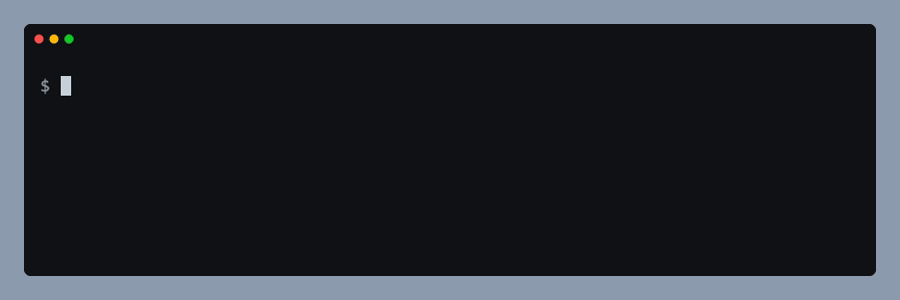
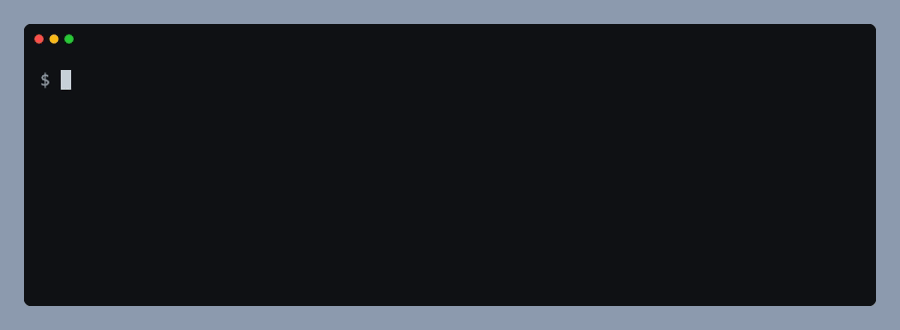

# Build

`opdk build` builds your plugin's CSS, bundles the plugin with esbuild for the browser platform, and then checks `main.js` for code that only exists under Node. `opdk build --vault --watch` is the same build aimed at a dev vault, rebuilding on every change.



## Why

Dashy 1.0.0 failed on every phone. Its build passed `--platform=node`, so esbuild took the `node` branch of the `yaml` package's export map and bundled a build that reads `process.env`. Desktop Obsidian has `process`, so the bug only showed on mobile. Nothing in Dashy's `src/` referred to `process`; it arrived through a dependency's export conditions, which is why reading the sources cannot catch it and the built file has to be checked. Snipsy's current bundle has the same problem.

The kit fixes the platform to `browser`, and the check fails the build if Node-only code gets in anyway. The check is skipped when `manifest.json` says `isDesktopOnly: true`.

## What `opdk build` does

The plugin id comes from `manifest.json`, the settings from the optional `opdk.config.mjs`. In order:

1. **CSS.** If the CSS entry (`src/styles/main.css`) exists, its `@import` lines are inlined into `styles.css`. If it does not exist, the step prints a `!` warning and a hand-written `styles.css` stays as it is. With `css: false` the step does not run. A missing `@import` target or an import cycle stops the whole build with exit 1, and the message names the files.
2. **Bundle.** esbuild bundles the entry (`src/main.ts`) into `main.js`: platform `browser`, format `cjs`, a footer that makes `module.exports` the plugin class, minified. A compile error is printed in esbuild's layout, followed by `build failed with N error(s)`, and the build exits 1.
3. **Bundle check.** `main.js` is searched for Node-only code. A finding prints `cannot run on mobile`, one line per finding, and exits 1. The bundle stays on disk. Nothing is checked for a desktop-only plugin.
4. **Done.** Exit 0 with `main.js` and `styles.css` in place.

`opdk build --vault [dir]` builds into a dev vault instead:

1. The folder is the `--vault` value, else `$VAULT_PLUGIN`. The first line says which one was used (`from --vault` or `from VAULT_PLUGIN`).
2. The build refuses, exits 1 and writes nothing when `dir/manifest.json` holds another plugin id (`--force` overrides this one only), when `dir` is the plugin root, when `dir` starts with `~` (nothing expands it), or when `--vault` is empty (`--vault ""`, `--vault=`). The last three are refused even with `--force`. With no `dir` and no `VAULT_PLUGIN` it stops and says to pass one.
3. An unminified `main.js` is written into `dir`.
4. `styles.css` is rebuilt from the CSS entry and copied into `dir` together with `manifest.json`. It is rebuilt rather than copied as is, because a stale copy is silent: a vault once shipped without the styles of two whole blocks while the TypeScript was fresh. With `css: false`, a `styles.css` in the plugin root is copied if it exists.
5. There is no bundle check in this mode.

With `--watch` the build then keeps running:

- esbuild watches the sources and rebuilds `main.js`; each rebuild repeats step 4.
- The CSS entry, every file it imports and `manifest.json` are polled every 300 ms (a recursive `fs.watch` was seconds late on macOS). A change repeats step 4. Imports added or removed while it runs are tracked.
- A compile error is printed and the watch keeps going; fix the file and the next build recovers.
- The same holds for CSS. When a step fails on a broken `@import`, the files it had read stay polled, so fixing any of them triggers the next sync, and so does creating a missing `@import` target.
- If the CSS entry does not exist when the watch starts, it prints `no <entry>, CSS not watched` once and polls only `manifest.json`; esbuild still watches the sources.
- `opdk.config.mjs` is read once at start. After editing it, restart the watch.
- Ctrl+C stops the watchers and exits 0.

## Quick start

In `package.json`:

```json
{
  "scripts": {
    "build": "opdk build",
    "dev:vault": "opdk build --vault --watch"
  },
  "devDependencies": {
    "obsidian-plugin-dev-kit": "github:Dimagious/obsidian-plugin-dev-kit#vX.Y.Z"
  }
}
```

Replace `vX.Y.Z` with the latest tag and pin it exactly.

`opdk.config.mjs` is optional. Without it you get the defaults in the table below:

```js
import { defineConfig } from "obsidian-plugin-dev-kit";

export default defineConfig({
    build: {
        loader: { ".png": "dataurl" },
        external: ["some-package"],
    },
});
```

For the dev loop, point the kit at the plugin folder inside your dev vault, either with `VAULT_PLUGIN` or with `--vault`:

```bash
VAULT_PLUGIN="$HOME/vault/.obsidian/plugins/my-plugin" npm run dev:vault
opdk build --vault ~/vault/.obsidian/plugins/my-plugin
```

`VAULT_PLUGIN` tends to stay exported in a shell. The build prints where the target came from and refuses a folder whose `manifest.json` holds another plugin id, so a stale variable cannot overwrite a different plugin. Pass `--force` to overwrite anyway. (The second command works because the shell expands `~` before `opdk` sees it; a `~` inside `VAULT_PLUGIN="~/..."` is not expanded and is refused.)

### esbuild in your plugin

The kit pins `esbuild` 0.28.2 and `opdk build` uses it, so a plugin needs no esbuild of its own for the build. Drop the plugin's own `esbuild` devDependency once no script of yours calls esbuild directly. Until then, pin the same version the kit does; otherwise you carry two binaries at two versions.

## Options

All keys go under `build` in `opdk.config.mjs` and are optional. An unknown key fails with a message naming it and the allowed keys; a value of the wrong type, with a message naming the key and what it must be.

| Key | Type | Default | Meaning |
|---|---|---|---|
| `entry` | string | `"src/main.ts"` | Bundle entry |
| `outfile` | string | `"main.js"` | Bundle output |
| `minify` | boolean | `true` | Minify the release bundle. Vault builds are never minified |
| `target` | string | `"es2020"` | esbuild target |
| `external` | string[] | `[]` | Added to the always-external `obsidian`, `electron`, `@codemirror/state`, `@codemirror/view` |
| `loader` | object | `{ ".css": "text" }` | esbuild loader per extension, for example `{ ".png": "dataurl" }`. Keys start with a dot. Your entries merge over the default, so an `import` of a `.css` file is a string unless you say otherwise |
| `css` | object or `false` | `{ entry: "src/styles/main.css", outfile: "styles.css" }` | CSS bundler, or `false` to skip it |
| `css.entry` | string | `"src/styles/main.css"` | CSS entry. `--watch` polls it and every file it imports |
| `css.outfile` | string | `"styles.css"` | CSS output |

Platform `browser`, format `cjs` and the footer that makes `module.exports` the plugin class are not configurable. Paths are relative to the plugin root.

Flags of `opdk build`:

| Flag | Meaning |
|---|---|
| `--vault [dir]`, `--vault=<dir>` | Build into a dev vault: unminified `main.js` in `dir`, then rebuilds `styles.css` and copies it and `manifest.json` there. `dir` defaults to `$VAULT_PLUGIN`. No bundle check. With `css: false`, a `styles.css` in the plugin root is copied if present |
| `--watch` | With `--vault`: rebuild on changes to the sources, the CSS entry and every file it imports (polled every 300 ms), and `manifest.json`. Stop with Ctrl+C. Rejected without `--vault` |
| `--force` | With `--vault`: write into a folder whose `manifest.json` holds a different plugin id. Rejected without `--vault` |

Other commands:

| Command | What it does |
|---|---|
| `opdk build-css` | Runs only the CSS step. Exit 1 when the CSS entry does not exist. With `css: false` it prints that CSS is disabled and exits 0. Takes no arguments |
| `opdk assert-bundle [file]` | Runs only the bundle check. `file` defaults to the build outfile. Exit 1 when the file is missing or has Node-only code; skipped for a desktop-only plugin |

The CSS bundler inlines `@import "x.css"` lines recursively, each path relative to the file that contains it. A missing import or an import cycle is an error that names the files. `@import` of a URL is left for the browser.

## What the bundle check looks for

| Finding | What it means |
|---|---|
| a `process` reference | `process.env`, `process.emitWarning`, `process.platform`, `process.version`, `process.cwd` or `process.argv` is in the bundle |
| a `node:` builtin import | a `require("node:...")` call |
| `__dirname` or `__filename` | either name is in the bundle |
| `LOG_TOKENS`, `LOG_STREAM`, `emitWarning` | property names from the Node build of a dependency; these three come from the Node build of `yaml`, the one Dashy 1.0.0 shipped. Minification renames variables but keeps property names, so the check looks for these |

## Example output

All output below is copied from real runs; paths under the plugin folder are shortened to `/Users/me/plugin`.

A clean build (the plugin id comes from `manifest.json`):

```text
$ opdk build
✓ css     src/styles/main.css -> styles.css (2 files, 4 lines)
· build   hello-plugin: bundling src/main.ts
✓ build   hello-plugin: main.js 0.6 KB
✓ bundle  main.js is free of Node-only references (0.6 KB)
```

`✓` is a step that passed, `✗` a step that failed, `·` progress and `!` a warning. Failures and esbuild's own messages go to stderr; the `✓ · !` lines go to stdout. In a terminal the lines are coloured (green, red, yellow, dim); piped into a file you get the same text without escape codes. Colour rules, in order: a non-empty `NO_COLOR` turns it off; `FORCE_COLOR` turns it on for any value except `0` and `false` (an empty value counts), even on a pipe or with `TERM=dumb`; `TERM=dumb` turns it off; `GITHUB_ACTIONS=true` turns it on, since the Actions log viewer renders it; otherwise colour needs a terminal. The format is for people: do not parse it in scripts, use the exit code.

### A bundle the check rejects

The source reads `process.env.HOME`, which does not exist on a phone:



```text
$ opdk build
✓ css     src/styles/main.css -> styles.css (1 file, 2 lines)
· build   hello-plugin: bundling src/main.ts
✓ build   hello-plugin: main.js 0.8 KB
✗ bundle  main.js cannot run on mobile:
            - a `process` reference: "process.env"
          Check the esbuild platform: an Obsidian plugin bundles as `browser`.
$ echo "exit code: $?"
exit code: 1
```

Read it from the top: the bundle was written, then the check found a Node-only reference and failed the build. Each `-` line names one finding, and the last line says what to check. A `process`, `node:` or `__dirname` line means your code or a dependency reaches for Node; a marker such as `LOG_TOKENS` means a dependency's Node build got bundled.

### A compile error and a broken CSS import

An esbuild error is printed in esbuild's layout, followed by one line from the kit. Here `src/main.ts` was cut off after its first line:

```text
$ opdk build
✓ css     src/styles/main.css -> styles.css (2 files, 4 lines)
· build   hello-plugin: bundling src/main.ts
✘ [ERROR] Expected identifier but found end of file

    src/main.ts:2:0:
      2 │ 
        ╵ ^

✗ build   hello-plugin: build failed with 1 error(s).
          Fix them and rerun `opdk build`.
```

A missing `@import` target stops the build before the bundle. The message names the importing file, the import and the path it looked for:

```text
$ opdk build
✗ opdk: command "build" failed: /Users/me/plugin/src/styles/main.css: @import "./nope.css" not found (looked for /Users/me/plugin/src/styles/nope.css). Fix the path or remove the import.
```

Both exit 1.

### The dev vault

The build prints where it writes, and refuses a folder that belongs to another plugin:

```text
$ opdk build --vault ~/vault/.obsidian/plugins/hello-plugin
· build   hello-plugin: vault target /Users/me/vault/.obsidian/plugins/hello-plugin (from --vault)
✓ build   hello-plugin: built /Users/me/vault/.obsidian/plugins/hello-plugin/main.js
✓ css     src/styles/main.css -> styles.css (2 files, 4 lines)
✓ build   hello-plugin: assets copied to /Users/me/vault/.obsidian/plugins/hello-plugin

$ VAULT_PLUGIN=~/vault/.obsidian/plugins/snipsy opdk build --vault
· build   hello-plugin: vault target /Users/me/vault/.obsidian/plugins/snipsy (from VAULT_PLUGIN)
✗ build   hello-plugin: /Users/me/vault/.obsidian/plugins/snipsy holds plugin snipsy, not hello-plugin. Check VAULT_PLUGIN / --vault, or pass --force to overwrite it.
```

The second command exits 1 and writes nothing.

A watch session, with a CSS file edited and then a source file:

```text
$ opdk build --vault ~/vault/.obsidian/plugins/hello-plugin --watch
· build   hello-plugin: vault target /Users/me/vault/.obsidian/plugins/hello-plugin (from --vault)
✓ build   hello-plugin: built /Users/me/vault/.obsidian/plugins/hello-plugin/main.js
✓ css     src/styles/main.css -> styles.css (2 files, 4 lines)
✓ build   hello-plugin: assets copied to /Users/me/vault/.obsidian/plugins/hello-plugin
· build   hello-plugin: Watching for changes (Ctrl+C to stop)
✓ css     src/styles/main.css -> styles.css (2 files, 4 lines)
✓ build   hello-plugin: assets copied to /Users/me/vault/.obsidian/plugins/hello-plugin
✓ build   hello-plugin: built /Users/me/vault/.obsidian/plugins/hello-plugin/main.js
✓ css     src/styles/main.css -> styles.css (2 files, 4 lines)
✓ build   hello-plugin: assets copied to /Users/me/vault/.obsidian/plugins/hello-plugin
· build   hello-plugin: watch stopped
```

### A mistyped option

```text
$ opdk build   # with build: { minfy: true } in opdk.config.mjs
✗ opdk: command "build" failed: /Users/me/plugin/opdk.config.mjs: unknown key(s) in "build": minfy. Allowed keys: entry, outfile, minify, target, external, loader, css.
```
