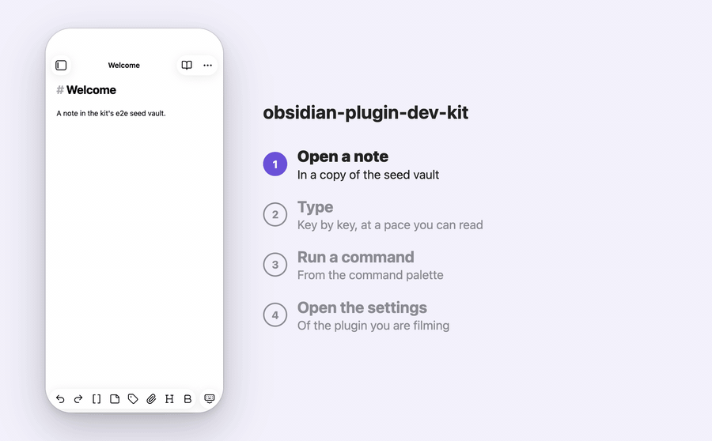

# Demo films

The `demo` fixture of `obsidian-plugin-dev-kit/e2e` records your plugin in the real Obsidian as a film of stills: a spec says "this frame, held for this many seconds, with this caption", and the kit takes a sharp, frozen picture of the window for each. `opdk demo` then turns the film into an MP4, a GIF and a poster, and, for a phone film with `layout: "phone-captions"` set in `opdk.config.mjs`, puts each frame beside its list of captions. No audio, no intro or outro cards.



The film above is the kit's own: `test/e2e-fixture/e2e/docs-film.spec.ts` records it on the kit's fixture plugin and seed vault, and `npm run docs:media:demo` encodes it with the settings in the kit's `opdk.config.mjs`.

## Why

Hand-written demo scripts have cost real plugins these things:

- Recording the Obsidian window as video caught every stutter of the machine and the cursor wherever it was, and that plugin's build script needed `python3` to do the rest.
- A retake appended frames to the old ones instead of replacing them.
- A reel script only warned when ffmpeg failed, so a run that made no GIF still ended green. Its films were twice as sharp only because the machine is a Retina Mac. A drawn phone film also showed a navigation bar that was wrong for the app; the kit frames the real Obsidian window instead of drawing a phone.

A film of stills makes timing a property of the script (`hold`) and not of the machine, pictures are taken at a fixed density (2x by default, on any monitor), a retake replaces the frames, and every encode step that fails fails the film.

## What a spec gets

`createObsidianTest` returns a `demo` fixture next to `win`, `app`, `vault` and `obsidian`:

| Part | What it does |
|---|---|
| `demo.film(options)` | Starts a film of stills. Returns a `Film` with `name`, `dir` and `shot({ hold, caption?, clip?, padding?, settle? })` |
| `demo.still(name, options?)` | One PNG, `<outDir>/stills/<name>.png`, optionally at the exact pixels of a destination (`preset`). `opdk demo` publishes it |
| `demo.moveAndClick(target)`, `demo.tap(target, { whilePressed? })` | A visible cursor that travels to the target and clicks it (desktop), or a tap dot that presses and releases (phone) |
| `demo.typeSlowly(text)`, `demo.typeSlowly(target, text)` | Types key by key, 40 ms apart by default |
| `demo.caption(text \| null)` | A caption bar at the bottom of the window, drawn into every frame until changed |
| `demo.beat(seconds)`, `demo.hideCursor()` | A deliberate pause for pacing a Playwright video of a test (the kit films stills only), and hiding the cursor or tap dot |
| `demo.cleanUi(options?)` | Hides the ribbon, status bar, tab headers, view header and inline title, and folds both sidebars |
| `demo.freezeTime(date)` | Fixes the window's clock |
| `demo.themes(["light", "dark"], scene)` | Runs a scene once per theme and names the output `-light` and `-dark` |

Every shot first freezes the page (after `obsidian.settle()` when the shot passes `settle: true`, see **Settling**): CSS transitions end, running animations finish (endless ones are paused for the picture and played again), the caret and the CodeMirror cursor layer are hidden, and two animation frames are awaited. Then the picture is taken through the same CDP session as the `obsidian` helpers, so it keeps the mobile emulation.

A plain `win.screenshot()` in the same test is fine, but the picture it takes is at the display's density (1x on a 1x display), not the fixture's. Playwright's screenshot drops the device metrics override from the page. The next `film.shot()` or `demo.still()` restores size and scale, on the desktop and after `obsidian.mobile()` alike: a phone film comes back at the phone size the session last set, at the film's scale (live tests: `a plain win.screenshot() between demo shots does not change the density of the next one` and `... after obsidian.mobile() leaves the next phone shot ...`). A second `obsidian.mobile()` after a plain screenshot restores the phone size as well. Use `demo.still()` for pictures that are published.

## Quick start

1. Install `ffmpeg`. `opdk demo` uses `OPDK_FFMPEG` when set (no fallback), otherwise `PATH`. macOS: `brew install ffmpeg`; Debian or Ubuntu: `sudo apt install ffmpeg`; Windows: `winget install ffmpeg`. The MP4 needs the `libx264` encoder, which the common builds have.
2. Set up the e2e module first ([docs/e2e.md](e2e.md)): `@playwright/test`, `electron` and the kit as devDependencies, a seed vault and `createObsidianTest`. The `phone-captions` layout renders in Electron from the same `electron` devDependency, so it needs nothing extra. A plain layout needs neither Electron nor Playwright when `opdk demo` runs.
3. Add `.opdk/` to `.gitignore`. The default output folder of the fixture, `.opdk/demo`, holds raw frames of the app and is not meant to be committed.
4. Use the `demo` option of `createObsidianTest`. It is optional; every key has a default:

```ts
import { createObsidianTest } from "obsidian-plugin-dev-kit/e2e";

export const { test, expect, onlyWhen } = createObsidianTest({
    seedVault: "e2e/vault",
    window: { width: 1200, height: 800 },
    demo: { forbiddenSelectors: [".my-plugin-api-key"] },
});
```

5. Write a spec that only runs on request, so a normal `playwright test` does not record films:

```ts
import { expect, onlyWhen, test } from "./fixtures.js";

onlyWhen("OPDK_E2E_FILM");

test("tour: open a note, type, run a command", async ({ obsidian, demo, win }) => {
    await demo.freezeTime("2026-03-14T09:26:00");
    await obsidian.mobile();
    await obsidian.openFile("Welcome.md", { mode: "source" });
    await demo.cleanUi();
    await obsidian.clearNotices();

    const film = demo.film({
        name: "tour",
        kind: "phone",
        captions: ["Open a note", "Type\nKey by key", "Run a command"],
    });
    await film.shot({ hold: 1.8, caption: 0 });

    const editor = win.locator(".cm-content[contenteditable=true]").first();
    await demo.tap(editor);
    await demo.typeSlowly("# Typed by the kit", { delayMs: 40 });
    await expect(editor).toContainText("Typed by the kit");
    await film.shot({ hold: 1.6, caption: 1 });

    await obsidian.runCommand("my-plugin:insert-date");
    await film.shot({ hold: 1.6, caption: 2 });
});
```

6. Add the `demo` section to `opdk.config.mjs` (all keys optional, see [Configuration](#configuration)):

```js
import { defineConfig } from "obsidian-plugin-dev-kit";

export default defineConfig({
    demo: {
        output: "docs/screens",
        gif: { width: 900 },
        layout: "phone-captions",
        phone: {
            title: "My plugin",
            accent: "#6f4fe0",
        },
        films: {
            overview: { layout: "plain", gif: { colors: 256, fps: 12 }, budget: { warnBytes: 3_000_000 } },
        },
    },
});
```

7. Add the scripts and run them:

```json
{
  "scripts": {
    "demo:record": "OPDK_E2E_FILM=1 playwright test film",
    "demo": "npm run build && npm run demo:record && opdk demo"
  }
}
```

The examples above were typechecked against the kit in a temporary project (strict; callbacks that read `document` need "DOM" in `lib`).

A film is encoded only when its recording test passed. A test that failed, timed out or was skipped leaves the film marked incomplete. `opdk demo` does not encode it: when you name it on the command line it fails with exit 1 (`<name>: not encoded` and the reason), and incomplete ones print as `!` lines (`<name>: skipped, <reason>`). Without names, when films were recorded and none of them is complete, the exit is 1 (`no complete film among the N recorded`), also when stills exist: stills do not stand in for films. With names, only what was named counts. A project with stills and no film folders at all exits 0.

## Recording a film

`demo.film({ kind, name?, fps?, captions?, clip?, padding?, scale?, cursor?, forbiddenSelectors?, allowForeignVault? })` starts a film and empties its folder, `<outDir>/films/<name>/`, so a retake replaces the frames of the earlier run.

- `kind` is `"phone"` for a film shot in the mobile emulation (`obsidian.mobile()`) and `"desktop"` for one without it. A shot fails when the window is in the other state.
- `name` defaults to the describe titles and the test title (and the project name when the config has several projects), lower case with dashes. Two tests of one run that get the same name fail with the other test's title, and so do two stills of one name. A later run is a retake and replaces them.
- `fps` is the rate the MP4 is encoded at, 1 to 60, default 15.
- `scale` is device pixels per CSS pixel, a whole number from 1 to 4. The default is `demo.scale` of the fixture options, 2.
- `cursor` is `true` by default; `false` keeps the cursor arrow out of this film's frames (see below).

`film.shot({ hold, caption?, clip?, padding?, settle? })` takes one frame. Call it after the assertion that the app is in the state the frame should show: nothing in a shot waits for the app unless it passes `settle: true`.

**Holds.** `hold` is seconds on screen and must be above 0. A film of stills takes its timing from `hold` and from nothing else. By default the GIF runs at 10 fps at most (`gif.fps` changes it), so a hold shorter than one GIF frame (0.1 s) can be skipped by the GIF; `opdk demo` warns and names the frame. For typing, take a shot every few characters with a hold of 0.4 to 0.6 s and a longer one at the end, as the film above does.

**Settling.** `settle: true` in `film.shot()` or `demo.still()` runs `obsidian.settle()` first: the shot waits until the DOM has been quiet for 150 ms, no font is loading and the images in view are complete, and only then freezes the page. With a `preset` the wait comes after the window has been resized, so the reflow is waited for too. Use it where a spec used to sleep before a picture. The default is `false`: a frame of a loading state that you film on purpose is taken as it is. If the page does not settle within `timeouts.helpers.ui` the shot fails with the error of `settle()` (what kept changing, how to raise the budget) and writes nothing. `settle()` takes `quietMs` and `root` when called on its own ([docs/e2e.md](e2e.md)); the shot options use the defaults, so call `obsidian.settle({ root })` yourself before a shot of a page that has a part that never stops changing. `settle` does not see drawing on a `<canvas>` (a chart) either, so a still of a canvas needs its own wait before the shot: poll a pixel with `getImageData` until it is not blank, or wait for the chart library's ready flag or animation-complete callback. `settle` sees changes that are happening, not ones that are scheduled: a pause longer than `quietMs` before the render looks settled, so assert on the element or raise `quietMs`.

**Pacing.** Two to four seconds per step reads well; one second per step is too fast to read a caption. Hold the first and the last frame a little longer than the rest.

**Loops.** A GIF repeats, so the film should end on the state it began with. The loop check compares the first and last frame (see Checks). The usual causes of a warning are a caption bar or the cursor arrow that is in the last frame and not in the first: clear them before the last shot (`demo.caption(null)`, `demo.hideCursor()`, or `cursor: false` for the film) so the last frame matches the first. A tour that goes through several screens does not return to the start on purpose; set `loop: "off"` for it in `demo.films.<name>`.

**Captions.** There are two kinds, and they are different things:

- `captions: [...]` in `film()` is the list that the `phone-captions` layout draws beside the phone. A shot points at one by index (`caption: 1`); a frame without `caption` keeps the previous step in the layout. A caption with a line break (`"Tap a day\nSee its value"`) is drawn as a heading and a text. An index outside the list fails the shot. The texts are not drawn into the frames.
- `demo.caption("text")` shows a bar at the bottom of the window, in every frame until you change it, and `demo.caption(null)` removes it. The text is plain text. Use it for a desktop film or a plain layout. Keep it under about 60 characters.

**Tap or click.** On a phone use `demo.tap(target)`: a small dot appears on the target, presses (it shrinks while the finger is down) and goes away after the finger is up. `tap(target, { whilePressed: () => film.shot({ hold: 0.3 }) })` takes a frame of the press. On the desktop use `demo.moveAndClick(target)`: the cursor travels in 14 steps and clicks. Both fail when the target is not visible. `typeSlowly(target, text)` clicks the target with the cursor first, so on a phone focus the field with `tap` and call `typeSlowly(text)`, which fails when nothing editable has focus. `hideCursor()` hides the cursor or the dot until the mouse moves again, for a frame that should show none.

**The cursor follows every mouse action.** The arrow is drawn wherever Playwright's mouse is, so a plain `click()`, `check()`, `selectOption()` or `hover()` moves it too, not only `moveAndClick()`. A film that never meant to show a cursor then has an arrow at the place of the last click. Pass `cursor: false` to `demo.film()` and the arrow stays hidden in that film's frames, however the page was clicked. The setting belongs to the film: a later film or still of the same test without it shows the arrow again. The tap dot of a phone film is not affected. `demo.still(name, { cursor: false })` does the same for one still and, like the film's setting, does not carry over to the next picture (the workaround `demo.hideCursor()` also works, until the mouse moves again).

**Pauses in a recorded take.** `demo.beat(seconds)` is a deliberate pause for the viewer of a recording. It is for pacing a Playwright video of a test; the kit films stills only, so use `hold`. It takes seconds (a helper that took milliseconds needs its calls converted) and throws above 60. The helpers do not pause by themselves.

**A clean UI.** `demo.cleanUi()` hides the ribbon, the view header and the inline title through Obsidian's own settings (saved at once, because `reload()` reloads without saving) and the status bar and tab headers through a class on the page. It also folds the left and right sidebars (`obsidian.collapseSidebars()`, waiting until they are folded): a frame with the file explorer open loses a fifth of its width to it. `cleanUi({ sidebars: false })` leaves the sidebars as they are. It survives `reload()`, `mobile()` and `desktop()`. Each call sets the five hidden parts, so `cleanUi({ statusBar: false })` hides the other four and shows the status bar, and the last call decides. Nothing is put back afterwards: the window is closed with the test. The sidebars are folded once and not unfolded by a later call. Overlays, the hidden parts and the frozen time all survive a reload, and a film goes on across it.

**Frozen time.** `demo.freezeTime(date)` fixes `new Date()`, `Date.now()` and `moment()` of the window at `date`; timers keep running. A date string without a time zone is read in the time zone of the machine and shown in it, so the same test gives the same text everywhere; a string with `Z` or an offset shows a different wall clock time in another zone. Caveats: the dates of files in Obsidian's explorer and in search come from the file system and are not frozen, and code that measures elapsed time with `Date.now()` sees none pass.

**Themes.** `demo.themes(["light", "dark"], scene)` runs `scene` once per theme, in order. Inside it `film()` and `still()` add `-light` or `-dark` to their names, so one scene gives `overview-light` and `overview-dark`. The theme stays on the last one afterwards. Settings for a theme pair are read from the base name (`films.overview`), and an exact name (`films["overview-dark"]`) wins over it.

**Clip.** `clip` is an element (its bounding box) or a rectangle `{ x, y, width, height }` in CSS pixels from the window's top-left corner, and `padding` adds CSS pixels around it, cut at the window edge. A clip that runs past the window fails instead of being cut: scroll the target into view or make the window bigger. A film's frames all have the same size, so a film-wide clip is set in `film()` and a per-shot one has to give the same size.

### Stills

`demo.still(name, { preset?, clip?, padding?, scale?, settle?, cursor? })` writes `<outDir>/stills/<name>.png`, replacing an earlier one. A preset gives exactly its pixels, puts the window at the CSS size that produces them and puts it back afterwards. A preset cannot be combined with `clip` or `scale`.

| Preset | Pixels | For |
|---|---|---|
| `readme` | 1000 x 640 | a README picture, as wide as GitHub shows it |
| `listing-desktop` | 1200 x 800 | the community plugin listing, desktop |
| `listing-phone` | 900 x 1600 | the listing, phone (a 450 x 800 window at 2x) |
| `social` | 1200 x 630 | a link preview card |

`opdk demo` publishes every still: it copies `<outDir>/stills/<name>.png` to the output folder (`docs/screens` by default) as `<name>.png`, next to the films, and only when the bytes there differ, so a retake of an unchanged picture leaves the file and git alone. A still is as sharp as the fixture's density, not the display's, which is the reason to use it for README and listing pictures instead of `win.screenshot()`. `demo.stills: false` turns this off, `demo.stills: { output: "docs/pictures" }` publishes them to another folder. Names on the command line select stills as well as films ([What `opdk demo` does](#what-opdk-demo-does)). Stills are copied as they are: they go through no size budget and no check.

### Pixels

Frames are taken at `demo.scale` (2 by default), so they are 2x on a 1x monitor too, and every frame is checked against the CSS size of the window times the scale. A 1200 x 800 desktop window gives 2400 x 1600 frames; a phone film in the default emulation (390 x 844 at scale 2) gives 780 x 1688. `opdk demo` warns about a film shot below scale 2 and about a manifest whose size does not match its scale. The GIF is made smaller (up to 1000 px wide by default); the MP4 and the poster keep the frame size.

## The privacy guard

A picture or film of someone's real notes can be published by mistake. The fixture refuses to capture in two cases:

- `OPDK_E2E_VAULT` is set (whatever it points at), which replaces the vault in `createObsidianTest({ seedVault })`:

  ```text
  film "tour" refused: OPDK_E2E_VAULT points this run at /somewhere/real-vault, not at the plugin's own seed vault, and a picture or film of someone's real notes could be published by mistake. Unset OPDK_E2E_VAULT, or pass allowForeignVault: true if you mean to shoot that vault.
  ```

- The seed vault lies outside the plugin folder, the directory `playwright test` runs in:

  ```text
  film "tour" refused: the seed vault <path> lies outside the plugin folder <path>, and a picture or film of a vault that is not the plugin's own could show private notes. Move the seed vault into the plugin folder, or pass allowForeignVault: true if you mean to shoot that vault.
  ```

`allowForeignVault: true` in `film()` or `still()` turns the refusal off for that call. Use it only for a vault you made for the purpose.

`forbiddenSelectors` are the second guard: CSS selectors that must never be in a picture, for example the element that shows an API key or a real account name. Set them in the `demo` option (`demo.forbiddenSelectors`, for every picture) or in one call (`forbiddenSelectors`). A shot fails when an element that matches one is visible, before anything is written:

```text
film "tour", frame 2 refused: an element matching the forbidden selector ".my-plugin-api-key" is visible, so it would be in the picture. Close or hide it before the shot, or remove the selector from demo.forbiddenSelectors if it is allowed here.
```

The default vault is the plugin's own seed vault, so a film made without any of this does not film a vault from outside the plugin. Obsidian's standard font is used; nothing pins a font.

## What `opdk demo` does

`opdk demo [names...]` reads `<demo.outDir>/films/<name>/manifest.json` (default `.opdk/demo`) and writes, for each complete film, into the output folder (`docs/screens` by default, where the three plugins keep their media):

| File | What it is |
|---|---|
| `<name>.mp4` | x264, yuv420p, crf 20, `-preset slow`, faststart, even dimensions, at the film's fps |
| `<name>.gif` | its own palette (`palettegen stats_mode=diff`, bayer dithering), 128 colours, 10 fps (the film's fps when that is lower), as wide as the frames up to 1000 px, never upscaled |
| `<name>-poster.png` | the film's first frame at the frame's resolution, so a site's `<video poster>` is as sharp as the video |

Without names every complete film is encoded and every still is copied. A name selects the film and the still of that name (both, when a film and a still share it), and only those: `opdk demo hero` copies the still `hero` and encodes no film, `opdk demo tour` encodes the film `tour` and copies no still. A name that is neither a film nor a still fails (with stills turned off, a still's name is not known, and the error adds `demo.stills is false, so stills are not selectable`). A run that has stills and no film copies them without needing ffmpeg. A still never replaces a film's file, written in the same run or recorded as the film's by an earlier one: a still named `tour-poster` next to the film `tour` fails with `still "tour-poster" would overwrite the poster of film "tour"; rename the still`, and the poster stays. Every file a run writes, stills included, is recorded in `<outDir>/published.json` for the stale-media check, which names a recorded file that is still on disk when its film or still is gone, or when its film or still was written without a failure in this run but not this file (an output turned off with `mp4: false`, or moved with `demo.output` or `demo.stills.output`). A film's file is encoded to a temporary name in a work folder and moved into the output folder when it is complete; a still is copied to `<name>.png.opdk-partial` next to its destination and renamed. Either way a failure leaves the previous good file. The command never deletes media. Frames go through ffmpeg's concat demuxer with a duration per frame; the last frame is listed again, so its whole hold plays, and the encode is capped at the sum of the holds.

### The phone layout

`layout: "phone-captions"` puts each phone frame on a 1000 x 620 CSS page at 2x (2000 x 1240 px): the phone, with rounded corners and a shadow, on the left, and the caption list on the right with the current step lit and the others dimmed. The heading is `phone.title`. Colours come from `phone` (`background`, `text`, `muted`, `accent`, `font`). Flat colours apply to every film. The `light` and `dark` entries apply only to films recorded inside `demo.themes()` and override the flat colours for that theme; a film without a theme uses the flat colours over the light defaults. Captions and the heading are HTML-escaped. A colour or font value that could end the CSS rule or start an escape, a comment or a request (`;` `{` `}` `<` `>` `\` `/*` `url(`) is rejected, and so are quotes in a colour.

The page is rendered in a bare hidden Electron window from the plugin's own `electron` devDependency, driven by Playwright, loaded only for this layout: about 2 s plus 0.1 s per frame. A missing `electron` or `@playwright/test` says what to install, and a step that hangs for 30 s fails the film. It needs no Python and no ffmpeg `drawtext`.

### Checks

| Check | What it says | Severity |
|---|---|---|
| ffmpeg | found through `OPDK_FFMPEG` when set (no fallback), otherwise `PATH`, and (for the MP4) `libx264` is checked before any work, with the install command in the message | fails |
| ffmpeg errors | a non-zero exit fails the film with the tail of stderr, and so does an exit 0 that printed errors (ffmpeg exits 0 after skipping a frame it cannot decode); an encode that runs for 10 minutes is killed | fails |
| size | a file above 2 MB warns, above 10 MB fails (GitHub's limit for images and GIFs attached to issues and pull requests); `budget` changes both | warns, fails |
| loop | the film's last recorded frame should equal its first, or the GIF jumps when it repeats; pixels whose channels differ by 8 of 255 or less count as equal, and the warning names the box and share of the pixels that differ more | warns; `loop: "fail"` fails, `"off"` skips |
| short holds | a frame held for less than one GIF frame can be skipped; the warning names the frame | warns |
| density | frames shot below scale 2, or a frame size that does not match the scale | warns |
| stale media | media this command wrote on an earlier run (recorded in `<outDir>/published.json`) that is still on disk and that no film or still produces any more: its film or still is gone from `<outDir>`, or it was written cleanly in this run without writing the file (an output turned off or moved). A film that failed or was not selected proves nothing about its files. Listed and never deleted | warns |
| theme pairs | a `-light` or `-dark` film whose partner is missing | warns |

Warnings print as `!` lines and leave the exit code alone. Exit 1 on anything that fails: no films and no stills, a name that is neither a film nor a still, an incomplete film named on the command line, without names, no complete film among the recorded films (stills do not make up for it), a still that cannot be copied or would overwrite a file a film wrote now or in an earlier run, an unusable manifest, a missing ffmpeg, an encode, a file over the fail limit and `loop: "fail"`.

### Example output

The kit's own film (`npm run docs:media:demo`), a run of two stills (the first changed since the last run, the second did not), then two failures:

```text
$ opdk demo demo
· demo    demo: composing 8 frames beside their captions in Electron
✓ demo    demo: gif 141 KB
$ opdk demo hero settings
✓ demo    still hero: png 312 KB
· demo    1 still unchanged: settings
$ opdk demo nosuch
✗ demo    no film or still named "nosuch" in /path/to/plugin/.opdk/demo
            Films there: demo
            Stills there: hero, settings
          Run the demo specs first (npx playwright test), or fix the name.
$ OPDK_FFMPEG=/nonexistent/ffmpeg opdk demo
✗ opdk: command "demo" failed: OPDK_FFMPEG=/nonexistent/ffmpeg cannot run (/nonexistent/ffmpeg could not run (spawn /nonexistent/ffmpeg ENOENT).). Point it at a working ffmpeg binary or unset it to use PATH.
```

A film that was renamed or deleted leaves its files behind, and the next run says so:

```text
! demo    media published by an earlier run of this command belongs to films or stills that no longer exist: docs/screens/old-name.gif, docs/screens/old-name.mp4. Delete them if they are obsolete; the command never removes files.
```

Only files `opdk demo` itself wrote are named. The record is `<outDir>/published.json` (output path to film name); it is created by the first run, so a project that has just updated sees no stale warning until its films have been encoded once. A file that was deleted drops out of the record on the next run. Unrelated pictures in the output folder are never listed. The record sits in `outDir`, next to the raw frames, and is not meant to be committed.

## Configuration

The `demo` section of `opdk.config.mjs`. Every key is optional, an unknown key fails and names itself. The film keys can be set for all films at the top level or for one film under `films.<name>`; a more specific value wins.

| Key | Type | Default | Meaning |
|---|---|---|---|
| `outDir` | string | `.opdk/demo` | Where the fixture wrote films. The same default as the fixture's `demo.outDir`; set both when you change it |
| `output` | string | `docs/screens` | Where finished media go, relative to the plugin root |
| `stills` | `{ output? }` or boolean | `true`, copied to `output` | Publishes `<outDir>/stills/<name>.png` as `<output>/<name>.png`, when the bytes differ. `false` turns it off, `output` is a separate folder. Top level only: a still belongs to no film |
| `gif` | `{ width?, colors?, fps? }` or `false` | 128 colours, 10 fps at most, width of the frames up to 1000 | `width` 16 to 8000 (not upscaled; a wider value warns), `colors` 2 to 256, `fps` 1 to 50 (used as given). `false` skips the GIF |
| `mp4` | boolean | `true` | `false` skips the MP4 |
| `poster` | `{ width? }`, boolean | `true`, the frame's resolution | `false` skips the poster |
| `layout` | `"plain"` or `"phone-captions"` | `"plain"` | `"phone-captions"` is for phone films with `captions` |
| `budget` | `{ warnBytes?, failBytes? }` | 2 MB, 10 MB | Per file. `warnBytes` must not be above `failBytes` |
| `loop` | `"warn"`, `"fail"`, `"off"` | `"warn"` | What to do when the last frame differs from the first |
| `phone` | object | neutral light and dark colours | `background`, `text`, `muted`, `accent`, `font`, `title`, and `light` and `dark` objects with the four colours |
| `films` | object keyed by film name | none | The same film keys, for one film. A theme pair reads the entry of its base name, the exact name wins |

The options of the `demo` fixture (`createObsidianTest({ demo })`):

| Key | Type | Default | Meaning |
|---|---|---|---|
| `outDir` | string | `.opdk/demo` | Where films and stills are written, relative to the directory `playwright test` runs in |
| `scale` | whole number 1 to 4 | 2 | Device pixels per CSS pixel |
| `forbiddenSelectors` | string[] | none | CSS selectors that must never be visible in a picture |

### Environment variables

| Variable | Meaning |
|---|---|
| `OPDK_FFMPEG` | Path of the ffmpeg binary; when set it is used with no fallback to `PATH` |
| `OPDK_COMPOSE_NO_SANDBOX` | `1` starts the Electron that draws the phone layout with `--no-sandbox`, for machines where Chromium's sandbox cannot start (a CI runner). The kit's CI sets it |
| `OPDK_E2E_VAULT` | Replaces the seed vault; the demo fixture then refuses to capture unless the call passes `allowForeignVault: true` |
| `OPDK_DEBUG` | `1` prints the stack of a failed command |

## CI

A film needs the real Obsidian, so recording belongs on a machine that has it. `opdk demo` itself needs ffmpeg, and, for the phone layout, Electron and a display. The kit's own `ci.yml` runs the encoder and layout tests this way on `ubuntu-latest`:

- install ffmpeg and a virtual display: `sudo apt-get install -y --no-install-recommends ffmpeg xvfb xauth`;
- download the Electron binary once (`node node_modules/electron/install.js`), cached by lockfile (`~/.cache/electron`);
- run the step under `xvfb-run -a` with `OPDK_COMPOSE_NO_SANDBOX: "1"`.

## Migrating from a plugin's own scripts

1. Install the kit, ffmpeg and (for the e2e fixture) the e2e dependencies ([docs/e2e.md](e2e.md)). Add `.opdk/` to `.gitignore`. To move the kit to a newer tag run `npm install -D "github:Dimagious/obsidian-plugin-dev-kit#<tag>"`. Editing the tag in `package.json` and running a plain `npm install` keeps the old entry in `package-lock.json`, and the old version stays installed.
2. Rewrite the recording specs on the `demo` fixture: a film of stills (`demo.film`, `film.shot`) in place of a screen recording or a screenshot loop, `demo.moveAndClick`, `demo.tap`, `demo.typeSlowly`, `demo.caption`, `demo.cleanUi`, `demo.freezeTime`, `demo.themes`.
3. Move the encoding settings to the `demo` section of `opdk.config.mjs` and delete the plugin's encoder script.
   Pictures for the README or the listing that a script takes with `win.screenshot()` move to `demo.still(name, { preset })`; `opdk demo` then puts them in the output folder, and their density no longer depends on the display. A `waitForTimeout` before such a picture becomes `settle: true` (or `obsidian.settle()` before an assertion); a pause longer than `quietMs` before the render looks settled, so assert on the element or raise `quietMs`.
4. Run the specs and `opdk demo`, compare the files with the old ones and list the differences in the plugin's CHANGELOG.

What changes for a plugin that had its own scripts. Anything not listed behaves as before.

- The poster is `<name>-poster.png` and the output folder `docs/screens`, the names and folder such plugins already used. The theme suffix is `-light` or `-dark`, as the fixture names themed films. ffmpeg is looked up through `OPDK_FFMPEG` first. A film is only encoded when its recording finished.
- The GIF defaults (128 colours, 10 fps at most, as wide as the frames up to 1000 px) replace each script's own numbers, which are now `gif` options per film. To keep your old output, copy its numbers: for example `gif: { colors: 256, fps: 4, width: 760 }`, or `gif: { fps: 12, width: 720 }`. The dither is the kit's (`stats_mode=diff`, bayer scale 5, `diff_mode=rectangle`), so only the numbers change.
- README and listing pictures taken with plain `win.screenshot` have the display's density. They move to `demo.still(name, { preset, settle: true })` (2x on any monitor, exactly the pixels of the destination), and `opdk demo` copies them to the output folder; a fixed `waitForTimeout` before such a picture becomes `settle: true` (a pause longer than `quietMs` before the render looks settled, so assert on the element or raise `quietMs`). Pictures that were committed from a 1x or a 2x display change size, so list them in the plugin's CHANGELOG.
- `beat()` takes seconds, not milliseconds. The helpers no longer pause by themselves: pacing is `beat()` for a Playwright video of a test and `hold` for films of stills.
- A phone film's MP4, GIF and poster come from the one command. The poster is the first frame (2000 x 1240). The GIF is made for the dark film too; set `gif: false` on the dark film to keep a light GIF only. The GIF is 10 fps at most by default: set `gif: { fps: 15 }` to keep a 15 fps phone GIF.
- The composed page (a phone with a lit step beside a list) is drawn from `phone`. The phone height is 540 px, and the heading and steps are the film's `title` and `captions`; a caption with a line break gives a heading and a text. The text is HTML-escaped.
- The kit renders with the plugin's Electron, not with Chrome through Playwright.
- A poster named `film-<name>-poster.png` keeps its name if the film is named `film-<name>`.
- A failed ffmpeg is not a warning: it fails the film (a script that used `set -euo pipefail` already stopped).
- If your runs point at a generated vault through `OPDK_E2E_VAULT`, note that the demo fixture refuses any set `OPDK_E2E_VAULT`. Make the generated vault the `seedVault`, or pass `allowForeignVault: true`.
- A script that composed voice-over and an outro: the kit does neither (no audio, no intro or outro cards), so only the film-to-media step moves.
- A demo recorded as a video of the window is shot again as a silent film of stills.

## Limits today

- Films are made of stills. There is no recording of the window as video, so an animation that matters (a spinner, a transition) shows as the frame the shot froze.
- No audio, no voice-over, no intro or outro cards.
- Verified on macOS with Obsidian 1.14.5. Capture on Linux CI is not built; the kit's CI runs only the encoder and the layout tests there. Windows is untested.
- The fixture records one window. Films in several languages are not covered.
- A retake is not byte-identical: pictures come from a real Obsidian, so a pixel here and there can differ between runs.
- `freezeTime` does not freeze the file dates in the explorer, and code that measures elapsed time sees none pass.
- The loop check treats a pixel as equal when each channel differs by at most 8 of 255, so noise below that is not reported. A tour that does not end where it began still warns; see **Loops**.
- A frame can hold network content (a page that loads data when it runs, a remote image), which differs between takes and can fail the loop check. For a stable film replace the plugin's fetching function with `obsidian.replace()` and return fixture data ([docs/e2e.md](e2e.md)).
