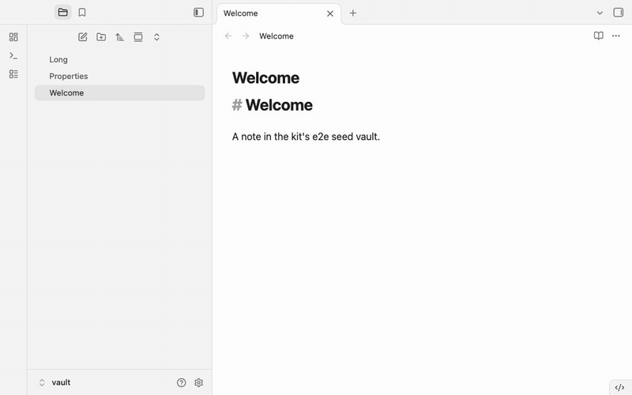

# End-to-end tests

`obsidian-plugin-dev-kit/e2e` runs Playwright specs against the real Obsidian. Every test gets its own Obsidian process, its own copy of a seed vault and its own user-data folder; your built plugin is installed and trusted before the window opens, and the test starts only when the workspace and every plugin have finished loading. When the test ends, however it ends, the process tree and the folders are gone. A set of helpers drives Settings, the command palette, the editor (including IME composition), themes, the mobile layout, and swaps a plugin's network client for a fake.



It runs Obsidian through Electron (`_electron.launch` on Obsidian's `app.asar`). Attaching to the real Obsidian binary over CDP is not built yet; see [Limits today](#limits-today).

## Why

Plugins that grow their own harness each pay separately for the same things:

- One plugin's specs broke on Obsidian 1.13 because Settings began to open in a second window. Five specs failed at once, and every harness has to work around it on its own.
- The "Trust author and enable plugins" dialog was handled by pressing Escape after a fixed wait, followed by sleeps to let plugins finish loading: waits of 800 ms and 500 ms and up to 5 s for the trust dialog in one harness, a fixed 1500 ms in two others. A slow start still raced them, and a plugin that never loaded was only noticed when a command was missing.
- Cleanup deleted the temp vault inside a `try` that ignored the error, so a folder Obsidian still held open stayed on disk, run after run.
- Playwright's `trace` and `video` options do not reach a window opened through `_electron`, so a red test left nothing to look at.

The kit fixes each of these once: the trust flag is set before the vault loads, readiness waits for plugin state, cleanup retries and then fails loudly with the path, and the Obsidian window gets its own trace and video.

## What a test gets

`createObsidianTest` returns a Playwright `test` whose tests can ask for four fixtures:

| Fixture | Type | What it is |
|---|---|---|
| `win` | `Page` | The Obsidian window, workspace laid out, every installed plugin loaded |
| `app` | `ElectronApplication` | The Electron app; `app.evaluate` runs in the main process. It is the only way to reach `BrowserWindow`, `app.getVersion()` and the like |
| `vault` | `VaultHandle` | The per-test copy of the seed vault: `path`, `resolve(rel)`, `exists(rel)`, `read(rel)`, `write(rel, content)`. A path that leaves the vault throws |
| `obsidian` | `ObsidianHelpers` | The [helpers](#helpers), bound to this window |

Obsidian's own `app` object (`app.workspace`, `app.plugins`) lives in the page, so you reach it with `win.evaluate`. The kit's helpers do that for the common cases.

## Quick start

Install the kit and the two things it runs on. The kit does not declare them as peer dependencies (npm would refuse to install the kit next to an older Playwright or Electron, even in a plugin without e2e); the e2e `globalSetup` checks them before the first test and fails with the install command when `@playwright/test` is older than 1.62 (or not major 1) or `electron` is older than 39:

```json
{
  "scripts": {
    "build": "opdk build",
    "e2e": "npm run build && playwright test"
  },
  "devDependencies": {
    "@playwright/test": "1.65.0",
    "electron": "44.10.2",
    "obsidian-plugin-dev-kit": "github:Dimagious/obsidian-plugin-dev-kit#v0.1.0"
  }
}
```

Replace `vX.Y.Z` with the latest tag and pin it exactly. The kit accepts `@playwright/test` `^1.62.0` and `electron` `>=39.0.0` and is developed against 1.65.0 and 44.10.2. Electron 42 and newer do not download their binary at install time but on first use (about 100 MB); 39 to 41 download it on install. Run `npx electron --version` once after installing, and in CI cache the Electron download (the `ELECTRON_CACHE` folder) and run that command in a step before the tests. Without it the run fails once, before any test starts, saying exactly this, instead of every test timing out in the launch.

The tests drive the Obsidian that is installed on the machine. On macOS the kit finds `/Applications/Obsidian.app`; elsewhere, set `OBSIDIAN_PATH` or the `obsidianPath` option.

Make a seed vault, a folder the tests copy. It can be any path (`seedVault` is resolved against the directory `playwright test` runs in), and the smallest one is a `.obsidian` folder and a note. If you use the palette helpers, enable the command palette in it:

```text
e2e/vault/.obsidian/core-plugins.json   ["file-explorer", "command-palette"]
e2e/vault/Welcome.md                    # Welcome
```

`e2e/fixtures.ts`:

```ts
import { createObsidianTest } from "obsidian-plugin-dev-kit/e2e";

export const { test, expect, onlyWhen } = createObsidianTest({
    seedVault: "e2e/vault",
});
```

By default the plugin installed is the one in the current directory: `manifest.json` and `main.js` (and `styles.css` if there is one) in the folder you run `playwright test` in. The plugin id comes from `manifest.json`.

`playwright.config.ts`:

```ts
import { defineObsidianConfig } from "obsidian-plugin-dev-kit/e2e";

export default defineObsidianConfig();
```

A first spec, `e2e/smoke.spec.ts`:

```ts
import { expect, test } from "./fixtures.js";

test("the plugin's command writes into the note", async ({ obsidian }) => {
    await obsidian.openFile("Welcome.md", { mode: "source" });
    await obsidian.editor().setCursor(1, 0);
    await obsidian.runCommand("my-plugin:insert-date");
    expect(await obsidian.editor().text()).toMatch(/\d{4}-\d{2}-\d{2}/);
});
```

Run `npm run e2e`. Each test starts a real Obsidian window, so expect it to open and close once per test. Build before you test: the stale-build guard refuses a `main.js` that is older than your sources.

The preset from `defineObsidianConfig` sets `testDir: "e2e"`, one worker, no parallel files, a 60 s test timeout, a 10 s `expect` timeout, `forbidOnly` and one retry when the `CI` variable is set, the `list` reporter plus an HTML report (`list` only on CI), and `trace: "retain-on-failure"`, `video: "retain-on-failure"`, `screenshot: "only-on-failure"`, plus a `globalSetup` that checks the Electron binary once (your own `globalSetup`, a string or a list, runs after it). Pass overrides as the argument; they win, and `expect` and `use` are merged key by key:

```ts
export default defineObsidianConfig({
    timeout: 90_000,
    use: { video: "on" },
});
```

Obsidian opens one window per process and the specs share nothing, so they run one at a time. A cold start can take 15 to 20 seconds on a busy machine.

### Typecheck the specs

A plugin's root `tsconfig.json` usually includes only `src/`, and may lack DOM, which `win.evaluate` callbacks reading `document` need. Specs pass functions to `win.evaluate` that read `document` and `window`, which needs the DOM library. Give the folder its own `e2e/tsconfig.json` that extends the root one:

```json
{
  "extends": "../tsconfig.json",
  "compilerOptions": { "lib": ["ES2020", "DOM", "DOM.Iterable"], "types": ["node"] },
  "include": ["./**/*.ts", "../playwright.config.ts"]
}
```

and check it next to the plugin's own sources:

```json
{
  "scripts": {
    "typecheck": "tsc -p tsconfig.json --noEmit && tsc -p e2e/tsconfig.json --noEmit"
  }
}
```

The snippet needs `typescript` and `@types/node`; set the ES entry of `lib` to the level the root uses. It was checked on a project whose root `tsconfig.json` has `lib: ["ES2020"]`, `module: "ESNext"`, `moduleResolution: "Bundler"` and `strict`, with the quick-start `fixtures.ts`, `playwright.config.ts` and spec (and a typed `evaluate`) under `e2e/`.

### Install from GitHub in CI

npm records a GitHub dependency in `package-lock.json` as `git+ssh://git@github.com/...`. For a public repository such as the kit this needs no SSH key: with SSH switched off (`GIT_SSH_COMMAND=false`), an empty npm cache and `npm ci`, the kit still installs, because npm fetches the tarball over https. If you install from a private fork, or `npm ci` fails with `Permission denied (publickey)`, tell git to use https for GitHub before installing. Locally, set it through the environment for one command:

```sh
GIT_CONFIG_COUNT=1 GIT_CONFIG_KEY_0=url.https://github.com/.insteadOf GIT_CONFIG_VALUE_0=ssh://git@github.com/ npm ci
```

On a CI runner, which is thrown away after the job, `git config --global url."https://github.com/".insteadOf ssh://git@github.com/` before `npm ci` does the same. Or write the dependency as `git+https://github.com/Dimagious/obsidian-plugin-dev-kit.git#v0.1.0` in `package.json`.

## What happens per test

1. The kit checks everything that can be checked without creating anything: Obsidian's `app.asar` exists (`OBSIDIAN_PATH`, then `obsidianPath`, then the macOS default; the first one that is set must exist, with no silent fall-through), every plugin folder has `manifest.json` and a built `main.js`, plugin ids are unique, every `data` key is an installed plugin, and the `main.js` of each checked plugin is not older than the newest file under its `src/` (compared by modification time; a test file, whose name ends in `.test.<ext>` or `.spec.<ext>`, does not count, every other file does). Which plugins are checked is set by [`staleBuildCheck`](#stale-build-check). A plugin folder without `src/` is not checked for staleness.
2. It checks that `electron` is installed and its binary is downloaded. The check runs once per run, in a global setup that `defineObsidianConfig` registers before your own `globalSetup`: a missing binary is one error and no test starts. A check in a fixture ran again for every test, because Playwright replaces a worker after each failed test and the fixture runs in the new one (59 tests gave 59 identical failures in one plugin). A config that does not use `defineObsidianConfig` has no global setup, so the session repeats the check for each test and a missing binary fails every test with the same message.
3. It creates two temp folders, `opdk-e2e-vault-<title>-XXXXXX` (the test title lowercased, reduced to a-z, 0-9 and hyphens, and cut to 40 characters) and `opdk-e2e-userdata-XXXXXX`, and copies the seed vault into a `vault/` subfolder of the first with symlinks resolved, so nothing a test does reaches the repository or a linked build. A symlink loop or a dangling link fails the copy, naming the link.
4. It writes `.obsidian/app.json` with `settingsPopoutWindow: false` and `alwaysUpdateLinks: true` unless the seed vault sets them (Settings in a popout is a second window the test does not drive, and renaming a file otherwise shows an "Update links?" modal that blocks forever).
5. It copies each plugin's `main.js`, `manifest.json` and `styles.css` into `.obsidian/plugins/<id>/`, writes `community-plugins.json` as the ids the seed vault enables plus the installed ones, and writes `data.json` for every plugin in the `data` option (replacing a seeded one).
6. It generates a vault id and writes `obsidian.json` into the user-data folder: the vault registered as the last opened (both auto-open markers), and `updateDisabled: true`, so Obsidian shows no vault picker and does not update itself during the run.
7. It launches Obsidian: `_electron.launch` with the `app.asar`, `--user-data-dir=<temp folder>` and your `electronArgs`. The environment is yours minus `ELECTRON_RUN_AS_NODE` (it makes Electron reject Chromium flags) and `VAULT_PLUGIN` (the dev vault of `opdk build --vault` has no business in a test). The launch is bounded by `timeouts.launch`.
8. It starts the trace when `use.trace` asks for one, so the startup is in it.
9. It sets the plugin trust flag (`enable-plugin-<vaultId>` in `localStorage`) with an init script that runs before the vault loads. The "Trust author and enable plugins" dialog never opens, and the kit never clicks it: both of its buttons have side effects. If it opens anyway, the readiness wait fails and says so. Native `alert`, `confirm` and `prompt` dialogs are dismissed.
10. It resizes the window when `window` is given.
11. It waits, polling every 50 ms with no sleeps, until `app.workspace.layoutReady` is true and, for every installed plugin, `app.plugins.plugins[id]` exists and `app.plugins.loadingPluginId` is no longer that id. Obsidian registers a plugin before it awaits its `onload()`, so a command or settings tab that `onload()` adds after an `await` exists when the fixtures resolve. The wait is bounded by `timeouts.ready`; a timeout names the state: `plugin still loading: <id>`, `plugin not loaded: <id>`, the trust dialog being open, or that the workspace was not ready. It waits for every plugin's `onload()` to finish, not for what the plugin draws afterwards: a view, a code block or a reading-view render that happens after `onload()` may not exist yet when your test starts.
12. It reads the running Obsidian version and puts it in the test report as the annotations `obsidian-version` and `launch-mode` (`electron`). When a version is pinned (`version` or `OBSIDIAN_VERSION`), the test also gets the annotation `obsidian-expected-version`, and it fails if the running version differs or cannot be read. Without a pinned version, an unreadable version is only recorded as `unknown`. The annotation `obsidian-launch-ms` holds the time from the launch call until the workspace and every plugin are ready.
13. Your test runs.

Durations: the session fixture runs with its own timeout, so Playwright counts its time in a separate slot and the reported test duration covers the test body only: not the setup (steps 1 to 12) and not the teardown. The launch itself (steps 7 to 11) is in the annotation `obsidian-launch-ms`; the teardown is not measured. Wall time of a run is roughly the sum of the three.

## Cleanup

Teardown runs when the test passes, fails, times out, and when any step above throws. In this order:

1. The trace is stopped while the app is still open, bounded by `timeouts.trace`, and written only if the mode keeps it.
2. Obsidian is closed, bounded by `timeouts.close` (Obsidian sometimes ignores a close request), and then the whole process tree is ended: the process group with SIGTERM and then SIGKILL on macOS and Linux, `taskkill /T /F` on Windows. A process that survives fails the test.
3. The video is finished and kept or deleted per its mode.
4. The user-data folder and the vault copy are removed, with retries, because Chromium helpers may still be writing for a moment after the main process exits. A folder that is still there after the retries fails the test, naming the path.

Every step runs even if an earlier one fails, and all failures are reported together. A setup error and a cleanup error are reported together too. The session fixture has its own timeout (launch + ready + 3 * close + 20 s), separate from the test timeout, so the kit's budgets fire first and the cleanup always gets to run.

A crashed or killed run (a `kill -9`, a power cut) cannot clean up after itself. When a worker starts, the kit removes `opdk-e2e-*` folders in the temp directory that are older than `sweepAfterHours` (default 2) and warns about any it cannot remove. `sweepLeftovers({ olderThanHours })` is exported if you want the same sweep in a `globalSetup`.

## Options

`createObsidianTest(options)` checks the options when `e2e/fixtures.ts` is imported, so a typo fails before any Obsidian starts. An unknown key fails naming it and the allowed keys; a wrong value names the key and what it must be. Relative paths are resolved against the directory `playwright test` runs in.

| Option | Type | Default | Meaning |
|---|---|---|---|
| `seedVault` | string | required | The vault copied for every test. The env var `OPDK_E2E_VAULT` replaces it |
| `plugins` | `{ dir: string, staleBuildCheck?: boolean }[]` | the plugin in the current directory | Plugin folders to install, each holding `manifest.json`, the built `main.js` and, if the plugin has one, `styles.css`. A non-empty list; the same folder twice is an error. `staleBuildCheck` on an entry overrides the top-level option for that plugin, see [Stale build check](#stale-build-check) |
| `data` | `Record<pluginId, object>` | `{}` | `data.json` content per plugin, written before Obsidian starts. Replaces a `data.json` in the seed vault. A key that is not an installed plugin id is an error |
| `window` | `{ width, height }` | what Obsidian opens with | Window size in points |
| `obsidianPath` | string | the macOS install | Obsidian's `app.asar`. The env var `OBSIDIAN_PATH` replaces it. On other platforms one of the two is required |
| `electronArgs` | string[] | `[]` | Extra Electron arguments, for example `--use-mock-keychain`. `--user-data-dir` is refused: the kit gives every test its own |
| `version` | string | unset | Fail the test when the running Obsidian is not this `x.y.z`. The env var `OBSIDIAN_VERSION` replaces it. Channels such as `latest` are refused: the kit checks the installed Obsidian, it does not download versions |
| `timeouts.launch` | ms | 45000 | `_electron.launch` |
| `timeouts.ready` | ms | 30000 | From the window opening until the workspace and every plugin are loaded. Also bounds the reload in `mobile()`, `desktop()` and `reload()` |
| `timeouts.close` | ms | 5000 | How long `app.close()` may take before the process tree is killed. Also bounds finishing the video |
| `timeouts.trace` | ms | 60000 | How long stopping the Obsidian trace may take. The stop writes every snapshot and screenshot of the test to a zip, so it grows with the length of the test; raise it for a long traced test |
| `timeouts.helpers.settings` | ms | 15000 | A plugin's settings tab to register (`openSettings(tab)`) |
| `timeouts.helpers.metadataCache` | ms | 45000 | Every markdown file to have its metadata cached (`waitForMetadataCache()`) |
| `timeouts.helpers.compose` | ms | 5000 | CodeMirror to leave a composition and show the composed text (`compose()`) |
| `timeouts.helpers.theme` | ms | 5000 | The body to get the class of the theme (`setTheme()`) |
| `timeouts.helpers.ui` | ms | 10000 | A dialog, the palette, the editor or a view to appear or go away (`openCommandPalette()`, `openFile()`, `editor().type()`, `closeSettings()`, `settle()` and others) |
| `staleBuildCheck` | boolean | `true` | Refuse the plugin in the current directory when its `main.js` is older than its newest source file (by modification time; `.test.<ext>` and `.spec.<ext>` files do not count). Other `plugins` entries are not checked unless they set it themselves. `OPDK_E2E_ALLOW_STALE_BUILD=1` turns every check off for one run |
| `sweepAfterHours` | number or `false` | 2 | Remove `opdk-e2e-*` temp folders older than this when a worker starts. `false` disables it |

Every wait inside the helpers has a budget and a failure that names the wait and the option to raise. Keep the helper budgets below the Playwright test timeout (60000 in the preset), or the test is killed before the helper can explain what it waited for.

Several plugins, a seeded `data.json` and a window size:

```ts
import { createObsidianTest } from "obsidian-plugin-dev-kit/e2e";

export const { test, expect, onlyWhen } = createObsidianTest({
    seedVault: "e2e/vault",
    plugins: [{ dir: "." }, { dir: "../my-other-plugin" }],
    data: { "my-plugin": { units: "metric", language: "en" } },
    window: { width: 1200, height: 900 },
    electronArgs: ["--use-mock-keychain"],
    timeouts: { ready: 45_000, helpers: { metadataCache: 60_000 } },
});
```

### Stale build check

A `main.js` older than the plugin's newest source file means the test would run code that no longer exists, so the kit refuses it and names both files. The check applies to the plugin in the current directory only; a second plugin from a sibling checkout (a dependency your plugin talks to) is installed as built and not checked. Its working tree is not yours to rebuild, and a source file touched by a `git pull` would otherwise fail every test. Switch it on or off per plugin:

```ts
createObsidianTest({
    seedVault: "e2e/vault",
    plugins: [
        { dir: "." },                                        // follows the top-level option (off in this example)
        { dir: "../sibling-plugin" },                        // not checked
        { dir: "../other-plugin", staleBuildCheck: true },   // checked
    ],
    staleBuildCheck: false,                                  // here: turns the check off for "." only
});
```

An entry's own value always wins over the top-level one, and `OPDK_E2E_ALLOW_STALE_BUILD=1` wins over everything. The error message carries these three ways out. A plugin from a sibling checkout has to be built there (`opdk build` in its folder) before the run.

### Environment variables

| Variable | Meaning |
|---|---|
| `OPDK_E2E_VAULT` | Replaces the `seedVault` option. A way to run the same specs on a copy of a real vault |
| `OBSIDIAN_PATH` | Replaces `obsidianPath`: Obsidian's `app.asar` |
| `OBSIDIAN_VERSION` | Replaces `version`: fail unless the running Obsidian is this `x.y.z` |
| `OPDK_E2E_ALLOW_STALE_BUILD` | `1` turns the stale-build guard off for every plugin for one run |
| `CI` | Read by the config preset: any value other than empty, `0` or `false` sets `forbidOnly`, one retry and the `list` reporter only |
| `ELECTRON_CACHE` | Electron's own: where its binary is downloaded. Cache it in CI |
| `ELECTRON_RUN_AS_NODE`, `VAULT_PLUGIN` | Removed from Obsidian's environment, see step 7 |

The kit does not read an env var for anything else. The names that gate your own specs are yours; see [Specs that run only on request](#specs-that-run-only-on-request).

## Helpers

The `obsidian` fixture. Each helper that waits polls Obsidian's state; the only fixed delays are the 15 ms between key presses of `editor().type()` and, inside `scrollThrough`, a 100 ms fallback per step for a window that draws no frames. A failure says what went wrong and what to do. The selectors the helpers rely on (`.modal.mod-settings`, `.vertical-tab-content`, `.prompt-input`, `.prompt-results`, `.notice` and the editor's) are Obsidian internals, verified on 1.14.5; when a newer Obsidian renames one, the helper that uses it fails with its own message.

### Settings

| Helper | What it does |
|---|---|
| `openSettings(tab?)` | Opens Settings in the main window and returns the content of the open tab. `tab` is a plugin id or a core tab id. A tab a plugin registers late is waited for; a missing one fails listing the registered ids. `const content = await obsidian.openSettings("my-plugin")` |
| `closeSettings()` | Closes the modal and waits until it is gone. `await obsidian.closeSettings()` |

`openSettings` returns the Locator of the settings content (`.modal.mod-settings .vertical-tab-content`), not of the page. Use it for lookups inside the tab (`content.getByText("Refresh")`). A filter on the whole page, such as `win.locator(".setting-item", { has: win.locator("input") })`, and a screenshot of the container (`win.locator(".modal.mod-settings").screenshot()`) go through `win`. Settings opens in the main window, so a settings screenshot has the size of the container in that window, not of a separate popout window as in a harness that opened Settings in a second window.

Settings opens in the main window because the kit sets `settingsPopoutWindow: false` (step 4). That is a default: a value in the seed vault's `.obsidian/app.json` wins. When Settings then opens in a second window, `openSettings` fails after `timeouts.helpers.ui` with a message that names the seed's `app.json` and the key.

### Commands

| Helper | What it does |
|---|---|
| `runCommand(id)` | Runs `app.commands.executeCommandById`. An unknown id fails with the close matches. A command whose `checkCallback` declined (it needs a state that is not there, such as an open note) fails too: the check comes first, because Obsidian reports success for it. `await obsidian.runCommand("my-plugin:sync")` |
| `openCommandPalette()` | Presses `Mod+P` and returns the palette's input |
| `runCommandFromPalette(name)` | Fills the palette input with `name`, waits for the entry to be selected, presses Enter, and waits for the palette to close. The palette needs the `command-palette` core plugin in the seed vault. `await obsidian.runCommandFromPalette("Sync now")` |
| `press(keys)` | Presses a key or combination; `Mod` is Cmd on macOS and Ctrl elsewhere. `await obsidian.press("Mod+Shift+F")` |

### Files and editor

| Helper | What it does |
|---|---|
| `openFile(path, { mode })` | Opens a note by vault path in the active tab. `mode` is `source`, `live` or `preview`, and is also forced on a note that is already open in the tab. `await obsidian.openFile("Notes/Today.md", { mode: "live" })` |
| `readingView(path?)` | Shows a note in reading view (the active note without `path`) |
| `collapseSidebars()` | Collapses the left and right side panels and waits until both report collapsed (they animate), so the note pane gets the whole window: a 390 px viewport is then 390 px of note. It is a helper of its own and not an option of `readingView()`, because it is about the window layout and serves source and live mode and screenshots as well. It then writes the workspace layout to disk, so a `reload()` right after it keeps the panels folded. Fails, naming the helper, when this Obsidian has no `workspace.leftSplit` and `rightSplit` to drive. `await obsidian.collapseSidebars()` |
| `expandSidebars()` | The inverse: expands both panels and waits until they are expanded |
| `editor().type(text)` | Types key by key, so per-keystroke listeners (a snippet expander) fire. It clicks the editor to focus it only when it is not focused: a second click would move the cursor |
| `editor().text()` | The whole document, read through `getValue()`, because CodeMirror keeps only the visible lines in the DOM |
| `editor().clear()` | Selects all, deletes, and waits until the document is empty |
| `editor().setCursor(line, ch)` | Both from 0; a position past the end is clamped |
| `editor().selection()` | `{ text, anchor, head }`, positions as `{ line, ch }` |

`openFile` does not collapse the side splits; call `collapseSidebars()` before it if your plugin needs the room. The editor is found without the `mod-active` class (Obsidian drops it from the leaf while a modal is open), so `type()` right after a closed modal works. `editor().text()` and `clear()` throw `There is no active editor` when no note is open in source or live mode.

`openFile`'s `mode` is the name of what you see. Obsidian's view state stores source and live preview as the same `mode: "source"`, told apart by a `source` flag, so a harness that set the state itself maps like this:

| Obsidian view state | `mode` |
|---|---|
| `{ mode: "source", source: false }` | `"live"` |
| `{ mode: "source", source: true }` | `"source"` |
| `{ mode: "preview" }` | `"preview"` |

```ts
await obsidian.openFile("Welcome.md", { mode: "source" });
await obsidian.editor().clear();
await obsidian.editor().type("::date");
expect(await obsidian.editor().text()).toContain("2026");
```

### IME

`editor().compose(text, { chunking })` enters text through real composition events (`Input.imeSetComposition`, then `Input.insertText`, over a CDP session), the way an input method does. `chunking` is `"word"` (default: each word composed and committed with its trailing space) or `"character"`. It inserts at the cursor, waits for CodeMirror to leave the composition between chunks, and fails when CodeMirror is still composing after a commit or the document did not change.

```ts
await obsidian.editor().compose("hello world", { chunking: "word" });
```

`compose` always commits. A test that must leave a composition uncommitted (a preedit that a plugin has to survive) needs a raw CDP session of its own: `win.context().newCDPSession(win)`.

### Appearance and state

| Helper | What it does |
|---|---|
| `setTheme({ mode, theme? })` | Switches light or dark and, with `theme`, a community theme (`""` for the default); waits until the page carries the class. An uninstalled theme fails listing the installed ones. `await obsidian.setTheme({ mode: "dark" })` |
| `waitForMetadataCache()` | Waits until every markdown file has its metadata cached. Returns at once for a vault with no markdown files |
| `clearNotices()` | Removes the notices on screen and returns how many there were. `const removed = await obsidian.clearNotices()` |
| `hideProperties()` | Hides the properties block of notes (a display setting; the notes are unchanged). Saved to app.json at once, so a later settings save does not bring the block back |
| `scrollThrough(selector?)` | Scrolls a reading view from top to bottom so blocks that draw when visible are drawn. `await obsidian.scrollThrough()` |
| `settle({ quietMs?, root? })` | Waits until the page stops changing: no DOM mutation for `quietMs` (150 ms), no font loading, every image in the viewport complete. `await obsidian.settle()` |

`scrollThrough` stays at the bottom and does not scroll back: the reading view drops the sections that leave the viewport, and scrolling back would drop the blocks it just drew. Without a selector it takes the active reading view; a selector that matches nothing fails.

`settle()` is the wait to use where a spec would sleep before a screenshot. It watches the DOM with a `MutationObserver` on the `<body>` (or on `root`, a CSS selector) and resolves when nothing was added, removed or changed there for `quietMs` and no web font is loading and every `` in the viewport has finished loading (a broken image counts as finished). The default of 150 ms is above the 100 ms debounce that views and plugins commonly use for a refresh, and still costs a fraction of a second on a page that is already still. CSS animations and transitions are not DOM changes, so an endless spinner or a blinking caret does not hold it up. It waits `timeouts.helpers.ui` at most; on timeout it throws an error that names `settle()`, the budget, what was still changing (the DOM, a font or a number of images) and how to raise it. It sees changes that are happening, not ones that are only scheduled: a gap between two changes longer than `quietMs` (a request that takes 400 ms between the click and the render) looks like a still page, so raise `quietMs` for such a view, or assert on the element it renders. Content that a script keeps rewriting (a clock, a live counter) inside the watched part never settles: pass a `root` that leaves it out. A `quietMs` that is not below the budget is refused up front. The demo helpers call it for you when a shot or a still passes `settle: true` ([docs/demo.md](demo.md)).

### Mobile

`mobile({ width, height, scale })` switches Obsidian to its mobile interface in a phone-sized viewport (390 x 844 at scale 2 unless given): CDP `Emulation.setDeviceMetricsOverride` plus `app.emulateMobile(true)`. That call reloads the window, and the only rejection the helper accepts is the one the reload causes; it then waits until every plugin has loaded again and keeps the viewport phone-sized. `desktop()` undoes it.

```ts
await obsidian.mobile();
await obsidian.runCommand("my-plugin:open-view");
await obsidian.mobile({ width: 820, height: 1180 });   // a tablet: the window loads again
await obsidian.desktop();
```

Screenshots: `mobile({ scale })` sets the device scale of the page, but `win.screenshot()` still uses the pixel ratio of the display the Obsidian window opened on, so the same test gives a 1x picture on one machine and a 2x one on a Retina display. Take `win.screenshot({ scale: "css" })` for a picture that is always one pixel per CSS pixel (390 pixels wide on the default phone).

A harness that made stills larger with `webFrame.setZoomFactor` gets different pictures here. The zoom changed the CSS size of the page, so a layout was drawn at a smaller width and every pixel measure scaled with it. The kit's stills are the page at its real CSS size, and their pixel size follows the display: on a Retina display `win.screenshot()` is 2x. For a picture of a fixed CSS size, set the viewport with `mobile({ width, height, scale })` and cut it with a `clip` in CSS pixels; `scale: "css"` gives 1 pixel per CSS pixel on any display:

```ts
await obsidian.mobile({ width: 450, height: 844, scale: 2 });
await win.screenshot({ path: "listing.png", clip: { x: 0, y: 0, width: 450, height: 800 } });                  // 900 x 1600 on a 2x display
await win.screenshot({ path: "listing-1x.png", clip: { x: 0, y: 0, width: 450, height: 800 }, scale: "css" });  // 450 x 800 anywhere
```

Verified on a 2x display with Obsidian 1.14.5: the first call gave 900 x 1600 and the second 450 x 800. `scale` in `mobile()` was 2 there; `mobile({ scale: 3 })` gave the same 900 x 1600, so the size of `win.screenshot()` is the display's ratio and not the `scale` option. If you need N-times pixels on a display that is not N times, the picture has to be scaled after it is taken.

A second `mobile()` with another width reloads the window, because the phone or tablet layout is decided from the viewport at load; the same width does not. Plugins with `isDesktopOnly: true` do not load on mobile, so the wait fails naming them.

### Reload

`reload()` runs Obsidian's own "Reload app without saving" command (`app:reload`) and returns once the new page is up and every enabled plugin has loaded again. It marks the old page, waits until it is gone, then waits for the plugins, the same way `mobile()` does after its reload, so the next line can use the editor without racing the load. `app:reload` reloads without saving, so text typed right before `reload()` can be lost to Obsidian's save debounce: wait for the file to be written first (for example poll `vault.read` until it holds the text). The page call that starts the reload never returns; that rejection is the only one accepted. Anything installed in the old page is gone afterwards, `replace()` fakes included. It fails naming the command when the Obsidian has no `app:reload`, with its own message when Obsidian refuses to run it, and with `timeouts.ready` as the budget when the window does not come back.

```ts
await obsidian.reload();
await obsidian.openFile("Notes/a.md");
```

### Page code

`evaluate(fn, arg?)` runs `fn(app, arg)` in the page, where `app` is Obsidian's `window.app`, and returns the result (a promise is awaited). A function that declares the `arg` parameter must be given one, as with `page.evaluate`. Type `app` with Obsidian's own `App` through a type-only import; the kit does not depend on the `obsidian` package, so the type comes from yours:

```ts
import type { App } from "obsidian";

const count = await obsidian.evaluate(
    (app: App, folder: string) => app.vault.getMarkdownFiles().filter((file) => file.path.startsWith(folder)).length,
    "Notes/",
);
```

The generics are `evaluate<R, A = undefined, App = unknown>`: `R` is the result, `A` the argument, `App` the type of `app`, all inferred from the function you pass. `fn` is serialised as source text and rebuilt in the page, so it cannot close over variables of the test or use imports (a variable it reads fails with `<name> is not defined`); pass what it needs as `arg`. `arg` and the result must be serialisable, as for `page.evaluate`: a `TFile` or a DOM node does not survive, return the fields you need. An exception thrown by `fn` fails the test with its message. `evaluate` fails with its own message when `window.app` is missing or `fn` is not a function expression (a method shorthand is not).

### Fakes

`replace(pluginId, propertyPath, impl, arg?)` assigns a function at `app.plugins.plugins[id].<path>` on the live plugin instance and returns `{ calls(), restore() }`. `impl` is a factory: it runs once in the page with `arg` and returns the replacement, so it can keep state between calls. A factory that declares a parameter must be given the `arg`.

```ts
const fake = await obsidian.replace(
    "my-plugin",
    "client.fetch",
    (delayMs: number) => async (path: string) => {
        await new Promise((resolve) => setTimeout(resolve, delayMs));
        return { path, items: [] };
    },
    250,
);
await obsidian.runCommand("my-plugin:sync");
expect(await fake.calls()).toEqual([["/items"]]);
await fake.restore();
```

The factory is serialised as source text and rebuilt in the page, so it cannot close over variables of the test or use imports. A variable the factory itself reads fails `replace()` with a message naming it (`the replacement factory threw: X is not defined`). A variable read inside the function it returns fails only when the plugin calls it, inside the plugin's own error handling, so put every value in `arg`, which must be serialisable, as for `page.evaluate`. Failure modes and delays belong in the function the factory returns. `replace` refuses a plugin that is not loaded, a property that does not exist, and a factory that throws or does not return a function. `calls()` records the arguments of each call, oldest first, and still works after `restore()`. After the window was reloaded (`mobile()`, `desktop()`) the page has forgotten the replacement: `calls()` and `restore()` fail with a clear message, unless `restore()` ran before the reload, in which case `calls()` returns the record it kept.

## Failure artifacts

Playwright's `use.trace` and `use.video` apply to browser contexts its own fixtures create; the window of an `_electron` launch is outside them. The kit reads the same settings from your config and records the Obsidian window itself, in every mode Playwright has (`off`, `on`, `retain-on-failure`, `on-first-retry`, `on-all-retries`, `retain-on-first-failure`, `retain-on-failure-and-retries`, and the object forms `{ mode, ... }`). A value it does not know fails naming the setting.

With the preset (`retain-on-failure`), a red test leaves in `test-results/<test folder>/`:

- `obsidian-trace.zip`, attached to the report as `trace`: the Obsidian window's screencast, actions and snapshots, recorded from right after the launch. Open it with `npx playwright show-trace test-results/<test folder>/obsidian-trace.zip`.
- A `.webm` video of the window in `test-results/<test folder>/video/`, attached as `video`. Pass a size with `use: { video: { mode: "on", size: { width: 1024, height: 640 } } }`.
- Playwright's own `trace.zip` and `test-failed-1.png`. The own trace holds the runner's steps and attachments and no screencast of the Obsidian window; use `obsidian-trace.zip`.

A recording that the mode does not keep is deleted. CDP mode, when it comes, will have a trace but no video: Playwright cannot record a page it only attached to.

## Specs that run only on request

A spec that should run only when asked (a capture run, a film, a long matrix) calls `onlyWhen` at the top of the file. The file is skipped unless that environment variable is exactly `1`, and a skipped file never starts Obsidian:

```ts
import { expect, onlyWhen, test } from "./fixtures.js";

onlyWhen("CAPTURE");

test("capture the dashboard", async ({ obsidian }) => {
    await obsidian.openFile("Dashboard.md", { mode: "preview" });
    await obsidian.scrollThrough();
});
```

```bash
CAPTURE=1 npx playwright test capture
```

This replaces `--grep-invert` in a script: the default run needs no flag to leave the spec out.

## Migrating from a plugin's own harness

1. Install `@playwright/test` and `electron` as devDependencies, and the kit.
2. Replace the plugin's `e2e/fixtures.ts` with `createObsidianTest({ seedVault, plugins, data, window })`. Delete the code it replaces: the vault copy, `obsidian.json`, plugin installation (a setup shell script too), `data.json` seeding, the Electron launch, the dialog handlers, the version reader, the folder removal.
3. Replace `playwright.config.ts` with `defineObsidianConfig()` and keep only what is yours (`globalSetup`, a different `testDir`).
4. Move the shared helpers to the `obsidian` fixture (see the table below) and keep only the plugin's own (page objects for its own views, for example).
5. Replace `--grep-invert` scripts and `test.skip` env checks with `onlyWhen`.
6. Search the plugin for callers of the old setup script (a capture script, `e2e-setup.sh`, a `pretest` or `e2e` entry in `package.json`, CI steps, docs) and replace each with the build command, `opdk build`. `grep -rn "e2e-setup\|capture.mjs" --exclude-dir=node_modules .` finds them with your script names.
7. Run the specs and read each difference below against your own.

What changes:

- `onlyWhen("X")` runs the file only when `X` is exactly `1`. An old `test.skip(!process.env.X)` gate accepted any non-empty value, so `X=true` or `X=yes` now skips the file; change the command that sets it.
- The seed vault is copied as it is, then the plugins are installed over it. A plugin folder in the seed (`<seed>/.obsidian/plugins/<id>`, committed or generated by an old setup script) is overwritten by the kit's install of `main.js`, `manifest.json` and `styles.css` (other files there, such as a seeded `data.json`, stay unless the `data` option replaces them). Delete the committed copy, and drop the `.gitignore` line that hid a generated one. The seed's `community-plugins.json` is optional: the kit writes the ids it lists plus the installed plugins.
- No fixed sleeps. Waits after enabling plugins, a wait for the trust dialog and fixed waits of 1500 ms are gone: the fixture waits for plugin state. The fixture waits for every plugin's `onload()` to finish, not for the plugin's first render. A spec that slept to let a view, a block or a reading-view render appear now needs a wait of its own for what it asserts (an assertion on the element, or `settle()` when the page just has to stop changing before a picture): `expect(locator).toBeVisible()` (a locator waits by itself), `expect.poll(...)` for a value read from the page, or `waitForFunction`. A spec like that fails on its own assertion or locator timeout, not with `plugin still loading`, which is reported only when an `onload()` is still running at `timeouts.ready`.
- No Escape, no `setEnable`. The trust flag is set before the vault loads; if the dialog opens anyway the test fails and says so.
- Cleanup retries and then fails with the folder path. A leftover that an old harness swallowed is now a failing test.
- A fallback that read the Obsidian version from the `obsidian.asar` on disk, and a `require("obsidian")` fallback (it never worked), are not carried over. The version is read with `ipcRenderer.sendSync("version")`, and an unreadable version fails the test when a version is pinned.
- `editor().text()` and `clear()` throw `There is no active editor` where a hand-written `editorText` helper returned an empty string and a `clearEditor` helper clicked a missing editor.
- `openFile` does not collapse the side splits, which a hand-written `openInReading` helper did. Call `collapseSidebars()` first.
- `compose()` fails when CodeMirror is still composing after a commit and when the document did not change; it always commits, so a spec that tests an uncommitted preedit keeps a raw CDP session.
- A plugin-specific vault variable becomes `OPDK_E2E_VAULT`. A video option read nowhere else goes; video now follows `use.video`.
- A harness mode that launches Obsidian over CDP (`E2E_LAUNCH=cdp`) has no replacement yet.

Where a shared helper goes:

| A helper you may have written | In the kit |
|---|---|
| Open settings, a settings spec | `obsidian.openSettings(tab)`, `closeSettings()` |
| Open the command palette, run a command | `openCommandPalette()`, `runCommandFromPalette(name)`, `runCommand(id)` |
| Type in the editor, read its text, clear it | `editor().type()`, `text()`, `clear()` |
| An IME composition spec | `editor().compose()` |
| Change the theme, wait for the index, remove notices, scroll so lazy blocks draw | `setTheme()`, `waitForMetadataCache()`, `clearNotices()`, `hideProperties()`, `scrollThrough()` |
| An `emulateMobile` block copied into several specs | `mobile()`, `desktop()` |
| A fake for a network client | `replace()` |
| Collapse the sidebars, collapse the splits before opening in reading view | `collapseSidebars()`, `expandSidebars()` |
| A fixed `waitForTimeout` before a screenshot | `settle()` |

## Limits today

- Electron launch mode only. CDP mode (the real Obsidian binary over `--remote-debugging-port`, which also allows pinned versions later) is not built yet, and `app` exists only in Electron mode.
- Verified on macOS with Obsidian 1.14.5. Linux CI (a virtual display, `--no-sandbox`) is a later item, and Windows is untested. The code has Windows branches (`taskkill`); nobody has run them.
- The kit checks the installed Obsidian's version; it does not download one.
- The Obsidian window opens on your screen during a run. The kit does not hide it.
- The e2e specs of the kit itself (`npm run e2e:smoke`) run by hand before a release, never in `npm test` or CI.
