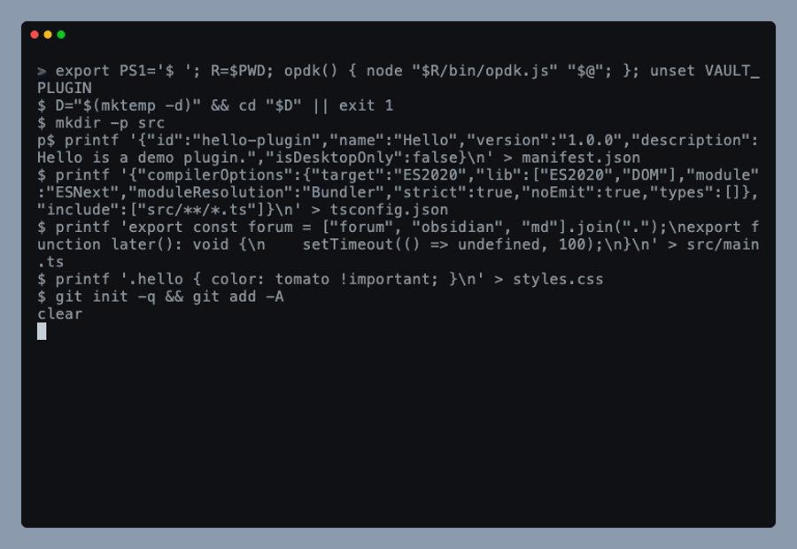

# Scanner

`opdk scan` runs, locally, the checks behind the Obsidian community plugin scanner's findings over your repository. Only the ESLint configuration is published upstream (in `eslint-plugin-obsidianmd`); the CSS and manifest checks reproduce findings seen on plugin listings. It exits 1 when a step has a finding: the scanner's ESLint warnings count as findings, advisory `!` lines do not. `obsidianPlugin()` is the ESLint config your plugin uses day to day, built on the same preset.


## Why

A plugin's public score dropped from 94% to 91% between 1.1.5 and 1.1.6. The cause was a `["forum", "obsidian", "md"].join(".")` workaround that the scanner reports as "Plugin assembles domain names at runtime from split/joined parts". Nothing local failed, so nobody saw it until the listing changed.

The first fix was a regex gate that guessed at the scanner's rules, and the guess was too narrow. When `eslint-plugin-obsidianmd` 0.5.1 came out, running its own scanner configuration over that plugin found seven warnings the gate had never seen, all in a folder the gate skipped. The listing's 24 CSS warnings came from files the old `!important` check never walked. `opdk scan` takes the guessing out: it runs the scanner's configuration itself, over the same files the scanner reads.

## Quick start

Add the command to `package.json` and run it before every release:

```json
{
  "scripts": {
    "scan": "opdk scan"
  },
  "devDependencies": {
    "eslint": "^10.14.0",
    "typescript": "^6.0.3",
    "obsidian-plugin-dev-kit": "github:Dimagious/obsidian-plugin-dev-kit#v0.3.0"
  }
}
```

Replace `vX.Y.Z` with the latest tag and pin it exactly. `eslint` (`^9.19.0 || ^10.0.0`) and `typescript` (`>=6.0.0 <6.1.0`) are peer dependencies of the kit. The scan runs on the ESLint and the TypeScript your plugin installs, and it fails before linting when that TypeScript is older than 6: the community scanner type-checks with TypeScript 6, and 5.x hides some of its warnings (see "Differences from the public scorecard"). Run `npm install -D typescript@6` and fix what `tsc` then reports. TypeScript 7 is outside the range until typescript-eslint supports it, so a bare `npm install -D typescript` (which installs the newest) fails on the peer range: name the 6. On ESLint 10, npm may print `ERESOLVE overriding peer dependency` warnings that come from `eslint-plugin-obsidianmd`'s own dependencies; the install still succeeds, and `npm ls` exits 1 for the same reason. The kit cannot change this; if you want quieter installs, set `loglevel=error` in the plugin's `.npmrc`, which also hides other npm warnings. Add `eslint` to your own devDependencies explicitly: without it npm installs ESLint 9 on its own, because the plugins nested under `eslint-plugin-obsidianmd` peer on `^9`. The kit brings `eslint-plugin-obsidianmd` 0.5.1, `typescript-eslint`, `postcss`, `doiuse`, pinned, so remove your own copies once nothing else uses them; two copies of `typescript-eslint` are two parsers.

```bash
git add -A      # the scan reads what git tracks
npx opdk scan
```

## What it checks

It reads the files `git ls-files` lists in the plugin folder, minus symlinks (the scanner reads the repository's files, and a link may point outside it). Build output (`main.js`, `coverage/`, `.preview/`) is untracked, so the scanner never sees it and neither does the scan. A new file counts once it is staged.

Run it from the plugin root: `eslint-plugin-obsidianmd` reads `manifest.json` from the current directory when it loads.

| Step | What it runs | Notes |
|---|---|---|
| `lint` | The scanner's ESLint configuration over the tracked files it does not ignore: the `SCANNER_IGNORES` list in `src/scanner/scanner-config.ts`, upstream's 48 entries less the `e2e` folder, with `eslint` removed from the tool-config group (see "Differences from the public scorecard"). Notable ones: `**/*.cjs`, `**/*.mjs`, `**/*.cts`, `**/*.mts` (so config files and scripts in those formats are not linted), locale folders (`i18n`, `locale`, `translations`, `l10n`), mocks, `e2e-tests`, `*.e2e.*`, tests (`*.test.*`, `*.spec.*`, `test/`, `tests/`, `__tests__/`), `scripts/`, `docs/`, `.obsidian`, `test-vault`, `pkg`, `automation`, build output (`dist`, `build`, `main.js`) and `esbuild.config.mjs`. The root `eslint.config.js` and `eslint.config.ts` are linted, and so is the `e2e/` folder (except its `*.spec.*` files; see "Differences from the public scorecard"); `.mjs`, `.cjs`, `.mts` and `.cts` configs stay ignored by their extension globs. Every file that is not ignored gets the rules the preset applies to it; the test-setup files (`global-setup.*`, `*-global-setup.*`, `test-setup.*`, `setupTests.*`, `*.setup.*`) and the files in `e2e/` also get the runtime rules the preset exempts them from (see "Differences from the public scorecard") | The configuration is the one in `eslint-plugin-obsidianmd`'s docs, version 0.5.1 (see Credits). Every finding fails, warnings too: the scanner turns most rules into warnings and a warning still lowers the score. `@typescript-eslint/no-unsafe-*` and the two command-id rules are on, as in the scanner's newest layer (see "Differences from the public scorecard"). Type information comes from the plugin's TypeScript, which must be 6. A file no `tsconfig.json` covers is linted without type information, and its findings print as one advisory `!` line per file that does not fail the scan: the one scorecard compared lists none of them, which is an inference, not something the scanner's authors confirm (see "Differences from the public scorecard") |
| `css` | Every tracked `.css` file, parsed with PostCSS | `!important`, `:has()`, and features Obsidian's Chromium lacks or supports only partly, from caniuse data through `doiuse`, against Chrome 142 (Electron 39, the Chromium of Obsidian 1.11.4). Comments are parsed out, so prose cannot trip a rule |
| `code` | Two checks on the script files under `src/`, tests excluded. Unlike the lint step, this one does read `.mjs`, `.cjs`, `.mts` and `.cts` files under `src/` | A host assembled from joined strings (`["forum", "md"].join(".")`, `.join("/")`), which no ESLint rule covers. And `@ts-ignore`, `@ts-expect-error`, `@ts-nocheck`, printed as a warning that does not fail the scan: the scanner's configuration leaves `ban-ts-comment` off. The domain check strips JSDoc and line comments first, so prose does not count; the `@ts-` check reads the raw text, because the directives are comments |
| `meta` | `manifest.json` | The description must not start with the plugin name. The name comes from the manifest |

Findings print as `file:line  rule  message`, grouped by step and sorted by file and line.

## Options

`opdk scan` takes no flags, and the `scan` section of `opdk.config.mjs` has no keys. Every file the scanner reads counts.

`scan.ignore` was removed. It skipped tracked files in every step, and what it skipped was still on the public scorecard: a plugin that listed `site/**` saw `opdk scan` pass while the scorecard showed 20 CSS warnings from `site/assets`. The scanner reads every tracked stylesheet and every script a tsconfig covers, and the exclusions that are known are built in (`SCANNER_IGNORES`, above). A config that still has the key fails with `"scan.ignore" was removed` before any check runs. To get a finding off the scorecard, fix it, or stop tracking the file (`git rm --cached`, or move it out of the repository). A script outside every tsconfig appears not to be read by the scanner (inferred from one scorecard, see "Differences from the public scorecard"), so `opdk scan` prints it as an advisory line and it needs no entry anywhere.

Two situations stop the scan before any check runs ("is not inside a git repository" or "no files to scan"), and each hint names its own fix. Not a git repository: run `git init` and `git add` the plugin's files, or run opdk from the plugin repository. A repository that tracks nothing in the folder: `git add` the files, or run opdk from the plugin repository.

## One ESLint config for the plugin: `obsidianPlugin()`

Use the same preset in your own ESLint config, so `npm run lint` and `opdk scan` agree. Name the file `eslint.config.mjs`, not `.js`: the scanner installs the kit without building it, so a `.js` or `.ts` config that imports the kit gets two `no-unsafe-*` warnings there, and the scanner ignores `.mjs` files (see "Differences from the public scorecard"). `obsidianPlugin({ rootDir: import.meta.dirname })` works from `.mjs` as it does from `.js`:

```js
// eslint.config.mjs
import { obsidianPlugin } from "obsidian-plugin-dev-kit/eslint";

export default [
    ...obsidianPlugin({ rootDir: import.meta.dirname, ignores: ["site/**"] }),
];
```

It is `eslint-plugin-obsidianmd`'s `recommended` preset (which carries ESLint's core rules and typescript-eslint's `recommendedTypeChecked`) plus what three real plugins all added to it: `prefer-window-timers` and `settings-tab/prefer-setting-definitions` as errors, and unused arguments, variables and caught errors as errors unless they start with `_`. One more rule is an error that the preset does not have: a bare `window.<member>` (below). Run `eslint . --max-warnings=0` so the warnings the preset leaves count as well.

| Option | Type | Default | Meaning |
|---|---|---|---|
| `rootDir` | string | `process.cwd()` | Folder the tsconfig is looked up from. Pass `import.meta.dirname` so an editor that starts ESLint elsewhere finds it |
| `tsconfig` | string | `"./tsconfig.json"` | tsconfig for the type-aware rules, relative to `rootDir` |
| `ignores` | string[] | `[]` | ESLint globs added to `DEFAULT_IGNORES`, which the entry point also exports so a config can extend or print it. It is what three real plugins all left out of their own lint (the intersection of their lists): `node_modules/**`, `coverage/**`, `dist/**`, `main.js`, `scripts/**`, `src/**/*.test.ts`, `vitest.config.ts`, `e2e/**`, `e2e-vault.pristine/**`, `playwright.config.ts`, `.obsidian-unpacked/**`, `design/**`. Paths only some plugins have (`site/**`, `.preview/**`, `src/test/**`, `tools/**`) go in your own `ignores` |

**Bare `window`.** A plain `window` is the main window; code that runs in a popout window must use `activeWindow`. The preset reports `window.addEventListener`, `window.innerWidth`, `window?.x` and `window["x"]` through `no-restricted-syntax`, and lets `window.open` and the timer functions (`setTimeout`, `clearTimeout`, `setInterval`, `clearInterval`, `requestAnimationFrame`, `cancelAnimationFrame`) through, because `prefer-window-timers` asks for those on `window`. A handler parameter that is named `window` is reported too, although it is the popout's own window: `workspace.on("window-open", (win, window) => ...)` is typed that way by `obsidian.d.ts`, so rename the binding (`(win, popoutWindow) => popoutWindow.addEventListener(...)`). This is the kit's own rule: the community scanner does not report it (`prefer-active-doc` covers `document` only), so `opdk scan` does not check it either. To turn it off, add a block after the preset:

```js
export default [
    ...obsidianPlugin({ rootDir: import.meta.dirname }),
    { files: ["**/*.ts"], rules: { "no-restricted-syntax": "off" } },
];
```

**`require()`.** The preset leaves `@typescript-eslint/no-require-imports` off, like upstream: `obsidianmd/no-nodejs-modules` already checks Node `require()`, and a bundled local `require("./x")` is not a phone problem. A plugin that wants the rule adds it in its own config:

```js
{ files: ["**/*.ts"], rules: { "@typescript-eslint/no-require-imports": "error" } },
```

The right fix for a Node module on mobile is a dynamic `import()` (or `require()`) guarded by `Platform.isDesktop`, never a static import of a Node module.

If the plugin sets `no-restricted-syntax` itself in a later block, that setting replaces the kit's selector; repeat the selector (`BARE_WINDOW_SELECTOR` is exported from `obsidian-plugin-dev-kit/eslint`) next to your own if you want both. A bare `window` that is not a member access (`const w = window`) is not reported.

Do not enable `@typescript-eslint/no-misused-promises` next to it: the preset replaces it with `obsidianmd/no-misused-promises`, which does not count Obsidian's chaining `then` (every `Setting` chain) as a Promise. The preset reads ESLint's core rules from the ESLint resolved next to `eslint-plugin-obsidianmd`. `no-useless-assignment` and `preserve-caught-error` exist in ESLint 9.39 but only ESLint 10 added them to `recommended`, so on 9 enable them yourself.

The import lives under `/eslint`, not in the package root, so reading `opdk.config.mjs` does not load the lint plugins. `opdk scan` itself loads ESLint, `eslint-plugin-obsidianmd` and `doiuse` only when it runs, so `opdk --help`, `opdk build` and the other commands start without them and without reading `manifest.json` through the plugin.

### ESLint 9 nested under eslint-plugin-obsidianmd

If the root has ESLint 10 and `node_modules/eslint-plugin-obsidianmd/node_modules/eslint` is a 9.x (seen in real plugin trees), the preset's core rules come from the nested 9, which lacks `preserve-caught-error`, `no-useless-assignment` and `no-unassigned-vars`. Nothing fails; the rules are just missing. `opdk scan` prints a `!` line naming both versions when the majors differ. Removing the plugin's own, older `eslint-plugin-obsidianmd` devDependency stays the first migration step (drop `typescript-eslint`, `@eslint/js` and `esbuild` at the same time if nothing else uses them), but it is not always enough: one plugin still had a nested 9 after it, another did not. The fix is to add `"overrides": { "eslint": "$eslint" }` to `package.json` and run `npm install` again; check with `npm explain eslint`. `npm dedupe` cannot remove the copy, because `@microsoft/eslint-plugin-sdl`, `eslint-plugin-import` and `eslint-plugin-react` peer on ESLint 9. The alternative is a `js.configs.recommended` block in your own `eslint.config.js`, which needs `@eslint/js` kept or added back.

## Example output

A plugin that passes (the GIF above):

```text
$ opdk scan
· scan    hello-plugin: 4 tracked files
✓ lint    0 findings (2 files, eslint-plugin-obsidianmd 0.5.1, typescript 6.0.3)
✓ css     0 findings (1 file)
✓ code    0 findings (1 file)
✓ meta    0 findings (manifest.json)
✓ scan    hello-plugin: 0 findings in 4 tracked files
```

The joined-domain regression again, plus a bare timer, an `!important` and a description that starts with the plugin name:



```text
$ opdk scan
· scan    hello-plugin: 4 tracked files
✗ lint    1 finding (2 files, eslint-plugin-obsidianmd 0.5.1, typescript 6.0.3):
            src/main.ts:3  obsidianmd/prefer-window-timers  Use 'window.setTimeout()' instead of 'setTimeout()' for popout window compatibility.
✗ css     1 finding (1 file):
            styles.css:1  css-no-important  `!important` is a scanner warning. Raise the selector's specificity instead.
✗ code    1 finding (1 file):
            src/main.ts:1  no-domain-assembly  Domain or URL assembled from array.join(): the scorecard flags it as evasion. Use a string literal.
✗ meta    1 finding (manifest.json):
            manifest.json:1  manifest-description-no-name-prefix  The description must not start with the plugin name. Current: "Hello is a demo plugin."
✗ scan    hello-plugin: 4 findings, each one lowers the community scorecard.
          Fix them and rerun `opdk scan`. Each line reads file:line  rule  message.
$ echo "exit code: $?"
exit code: 1
```

An advisory finding prints as a `!` line and leaves the exit code alone. So does a script no tsconfig covers (here a site script with 36 findings, none of them on the scorecard compared):

```text
! lint    site/assets/site.js:5  outside-tsconfig  36 lint findings in a file no tsconfig covers (first: obsidianmd/prefer-active-doc). The scorecard compared did not list files outside every tsconfig project (inferred from one scorecard), and would if a tsconfig covered this one.
✓ lint    0 findings (33 files, eslint-plugin-obsidianmd 0.5.1, typescript 6.0.3, 1 outside every tsconfig, advisory)
✓ css     0 findings (4 files)
! code    src/stub.ts:1  ts-suppression  TypeScript suppression directive: prefer augmenting Obsidian's types in the plugin.
✓ code    0 findings (2 files)
```

## Differences from the public scorecard

- **Layers.** The scanner keeps layers by submission date. Upstream's docs say the older ones switch `@typescript-eslint/no-unsafe-*` and the command-id rules off, and the newest has them back at `warn`. A plugin's public scorecard (version 1.7.1) lists them, so the kit runs the newest layer: a clean scan here is clean in the older layers too. Before this, `opdk scan` missed those warnings.
- **`eslint.config.js` and `.ts`.** The kit lints them (only these two; `.mjs`, `.cjs`, `.mts` and `.cts` configs stay ignored by the extension globs), with type information, as the live scanner does. That plugin's 1.7.1 scorecard has four `no-unsafe-*` warnings in its root `eslint.config.js` (lines 14 to 17, `any` from an untyped helper), although `eslint-plugin-obsidianmd` 0.5.1's documented ignore list contains `**/eslint.config.*`. The kit follows the live scanner over the 0.5.1 text here (owner decision, 2026-11-11): `eslint` is removed from that ignore entry and the project service has `allowDefaultProject: ["eslint.config.*"]`. A config that the plugin's tsconfig already covers is linted with types through that tsconfig instead (typescript-eslint refuses a file that is both). `opdk scan` on that version reports the same four. Fix them in the file or type the helper.
- **A plugin's `eslint.config.js` that imports the kit.** The scanner appears to install a plugin's dependencies without running install scripts, so the kit, which builds `dist/` in `prepare`, has nothing to resolve there. One plugin's 1.7.2 `eslint.config.js` calls `obsidianPlugin()` from `obsidian-plugin-dev-kit/eslint` on line 9, and its scorecard has exactly one `no-unsafe-call` and one `no-unsafe-assignment` (the spread of the result) beyond the other findings. `opdk scan` lints every script that imports `obsidian-plugin-dev-kit` from text where that package does not exist, which reproduces both, and the two findings carry a hint to rename the file (for a file that is not an `eslint.config.*`, the hint says to keep it out of every tsconfig instead). The cause is inferred from that one scorecard, and from deleting the kit's `dist/eslint` in a copy of the plugin; the scanner's authors have not confirmed it. The fix is to name the config `eslint.config.mjs`: the scanner ignores `**/*.mjs`, so the file is not linted, and `obsidianPlugin({ rootDir: import.meta.dirname })` works from it. A block `eslint-disable` comment for the two rules is not a fix: it fails the plugin's own lint (unused directive and `eslint-comments/disable-enable-pair`), and `opdk scan` then reports `disable-enable-pair` instead.
- **Files outside every tsconfig.** The kit used to lint them without type information and fail on the findings. A plugin's `site/assets/site.js` (not in any tsconfig) had 36 findings that way (`prefer-active-doc` 27, `no-restricted-globals` 2, `no-unsanitized/property` 2, `sdl/no-inner-html` 2, `no-unused-vars` 2, `prefer-window-timers` 1), and the plugin's public scorecard has none of them, while it lists the 20 CSS warnings of the same folder. So the scan now prints them as one advisory line per file and does not fail. This is inferred from that single comparison, not confirmed by the scanner's authors (the other explanation, a scanner exclusion for `assets/` or site scripts, fits it too). If a tsconfig covers such a file, the scan reports it as a failing finding.
- **Test-setup files: `global-setup.*`, `*-global-setup.*`, `test-setup.*`, `setupTests.*`, `*.setup.*`.** `eslint-plugin-obsidianmd` exempts test files from `no-nodejs-modules` and the other Obsidian-runtime rules, but the scanner's ignore list does not name these. One plugin's `integration/global-setup.ts` imports `node:fs`, `node:path` and `node:url` and its scorecard has three `no-nodejs-modules` warnings for them. That is the only evidence; the other four names are the same family in the preset's own list and are inferred from it, not seen on a scorecard. The kit lifts the exemption for exactly these patterns (`SETUP_FILE_PATTERNS`, `withoutRuntimeExemptions`). Everything else the preset exempts stays exempt, because nothing shows the scanner reports it: worker files (`*.worker.*`, `*-worker.*`, `*_worker.*`, `workers/**`; a Worker has no `activeWindow`, so `prefer-window-timers` and `no-global-this` would be wrong advice there), the `test-helpers`, `test-support` and `test-utils` folders, `*.testing.*`, `testUtils*`, and tool configs and scripts. A file the scanner's own list names stays out of the scan.
- **The `e2e/` folder.** Upstream ignores `**/e2e/**` and the preset exempts it from the Obsidian-runtime rules, but the live scanner lints the files in `e2e/` that a `tsconfig.json` covers. A plugin's 1.1.0 scorecard listed nothing from `e2e/`; its 1.1.1 added `e2e/tsconfig.json` (extends the root one, includes `./**/*.ts`) and the scorecard then lists 21 findings in `e2e/fixtures.ts`, `e2e/demo-*.ts` and `e2e/live-key.ts`: the `no-unsafe-*` warnings and also `prefer-window-timers`, `no-global-this` and `no-nodejs-modules`. It has no `prefer-active-doc` for the one `document.querySelector` in `e2e/fixtures.ts` (inside a callback passed to Playwright's `evaluate`, next to a `setTimeout` in the same callback that is reported), so that rule stays off for `e2e/` (`E2E_EXEMPT_RULE`); it is not known whether the scanner exempts the rule in the folder, skips `document` inside such a callback, or does not report `prefer-active-doc` on any file a tsconfig covers (no scorecard seen shows it on one). `*.spec.*` files in the folder are not listed. Another plugin keeps its e2e helpers in a root `tsconfig.e2e.json`, which the project service does not read (it finds `tsconfig.json` only); its scorecard has none of them, which fits the rule that a file outside every tsconfig is not reported. So `opdk scan` lints `e2e/` like any folder and lifts the preset's runtime exemption for it (`E2E_FILE_PATTERNS`), while `*.spec.*` stays ignored. `e2e-tests/` and `*.e2e.*` stay ignored and exempt: no scorecard shows a plugin with either. Your own `npm run lint` keeps `e2e/**` in `obsidianPlugin()`'s default ignores, so it will not show these findings. If a plugin's scan now fails on `e2e/`, either fix the runtime findings in the code (a `window.setTimeout`, `activeWindow`) or keep e2e type-checking out of `tsconfig.json`: move it to a root `tsconfig.e2e.json` and point the e2e type-check at it. The `no-unsafe-*` findings (14 of the 21) are not code problems: they come from the imports of the kit (`createObsidianTest`, `obsidian.evaluate`, `obsidian.replace`), which the scanner cannot resolve because it installs the kit without building it, so typing the `evaluate` result does not remove them and only the tsconfig move does. Their hint says so, and a second scorecard supports the "kit not built" inference of the entry above. This is inferred from two scorecards, not confirmed by the scanner's authors.
- **`esModuleInterop` and `moment`.** `opdk scan` type-checks with TypeScript 6 and the plugin's own compiler options. The cause of the gap is `esModuleInterop`: TypeScript 6 forces it on, and TypeScript 5 with `esModuleInterop: true` behaves the same. Under it the namespace import of an `export =` module is not callable, and `obsidian`'s typings declare `moment` that way (`export const moment: typeof Moment`, with `Moment` from `import * as Moment from 'moment'`). A call such as `moment(date).format("YYYY-MM-DD")` with `moment` imported from `obsidian` is therefore TS2349 ("This expression is not callable") in the plugin's own `tsc --noEmit`, and `no-unsafe-call`, `no-unsafe-member-access` and `no-unsafe-return` warnings in the scan. A plugin on TypeScript 5 without `esModuleInterop` gets neither. Checked on a minimal project with `obsidian` 1.14.4 and `moment` 2.31.0:

  | TypeScript | `esModuleInterop` | `moment(...)` from `obsidian` |
  |---|---|---|
  | 5.9.3 | unset or `false` | compiles |
  | 5.9.3 | `true` | TS2349 |
  | 6.0.3 | unset (forced on) | TS2349 |
  | 6.0.3 | `false` with `ignoreDeprecations: "6.0"` | compiles |
  | 6.0.3 | `false` | TS5107 (the option is deprecated), no type check |

  The public scorecard of one plugin (1.7.1) lists exactly these three on such a line although `moment` was a devDependency, and `opdk scan` with the plugin's TypeScript 5.9 reported 0 there. So the live scanner very likely runs TypeScript 6 (inferred from this symptom, not confirmed). `opdk scan` therefore needs TypeScript 6 in the plugin: it reads the version typescript-eslint resolves and, on 5.x or older, fails before linting with a `✗ scan` line that says to run `npm install -D typescript@6`; with no TypeScript installed it fails the same way. It prints the version it used in the `lint` line (`typescript 6.0.3`). The plugin's own `tsc` then reports the same TS2349 on `moment`, which is where to fix it.

  The plugin has to fix the call, not the scan. The fix is to type it instead of relying on the `obsidian` typing:

  ```ts
  import { moment } from "obsidian";

  interface MomentLike {
      format(pattern: string): string;
  }
  const toMoment = moment as unknown as (input: Date) => MomentLike;
  ```

  Under TypeScript 6 this scans clean.
- **`obsidianmd/ui/sentence-case`.** Off here and on the scorecard. Upstream's docs list "the three sentence-case rules" among the rules the scanner disables for every layer, and the newest layer's additions do not include them. A plugin that wants the check turns it on itself, as in `eslint-plugin-obsidianmd`'s "Upgrading to 0.5.0" section ("`ui/sentence-case` is off"): `{ rules: { "obsidianmd/ui/sentence-case": ["warn", { enforceCamelCaseLower: true }] } }`.
- **The kit can be stricter.** It uses the `recommended` set of the ESLint that runs it, and ESLint 10 adds `preserve-caught-error` and `no-useless-assignment` to it; it also reports the `moment` ban (`depend/ban-dependencies`). On that version these three are not on the public scorecard, so `opdk scan` reports 12 findings there against the scorecard's 9.
- **Partly supported CSS.** `css-browser-feature/*` findings are real: the public scorecard reports "partially supported" features too (`text-decoration: underline dotted ...`, for one plugin). Only bare `underline` and `none` pass.
- **Browser target.** The scorecard names an Obsidian version per plugin: "Obsidian 1.4.5" for a plugin with `minAppVersion` 1.5.0 and "Obsidian 1.11.4" in listings of plugins with `minAppVersion` 1.13.0. How the scanner maps a plugin to a version is not documented, so the kit checks one target, Chrome 142 (Obsidian 1.11.4). A feature that only an older Chromium lacks can appear on the scorecard of a plugin with a low `minAppVersion` and not here.
- **Parity, measured.** `opdk scan` on the release tags of three plugins gives the counts per message that their public scorecards list (read on 2026-11-13): 8 warnings, 20 and 0. The scorecard tab of a listing is rendered in the browser, so it cannot be fetched by a script; any later comparison is by hand.

## Reading a failure

- The `✗` lines and their findings go to stderr, the `✓ · !` lines to stdout, and the exit code is 1 on any failing finding. Do not parse the text; use the exit code.
- A rule such as `obsidianmd/prefer-active-doc` is documented in `eslint-plugin-obsidianmd`. Fix the code, or add a disable comment with a description (the scanner honours them).
- `css-browser-feature/<name>` names the caniuse feature. "Partially supported" means Chrome 142 has it with gaps; read the caniuse notes for that feature before keeping it.
- `parse-error` means ESLint could not read the file. Fix the syntax, or stop tracking the file if it is not plugin code.
- `outside-tsconfig` (a `!` line) is a file no tsconfig covers; the scorecard compared lists none of its findings (an inference from one scorecard) and they do not fail the scan.
- `css-syntax` means PostCSS could not parse a stylesheet.

When `eslint-plugin-obsidianmd` is bumped, the mirrored configuration has to be diffed again: a test pins the version it was taken from, so a bump fails the kit's tests until someone does.

## Origin

The ESLint configuration in `opdk scan` mirrors "Community plugin scanner configuration" in `eslint-plugin-obsidianmd` 0.5.1 (`docs/configuration.md`), with the differences listed at the top of `src/scanner/scanner-config.ts`. The ignored paths are upstream's 48 less the `e2e` folder, with `eslint` removed from the tool-config group (see "Differences from the public scorecard"); its first three (`main.js`, `**/*.min.js`, `**/{dist,build,out,release}/**`) are its stand-ins for bundled output, and upstream says to drop `main.js` for a plugin written in JavaScript. The CSS, host and manifest checks follow the ones a plugin's own scorecard script grew on 2026-11-09.
